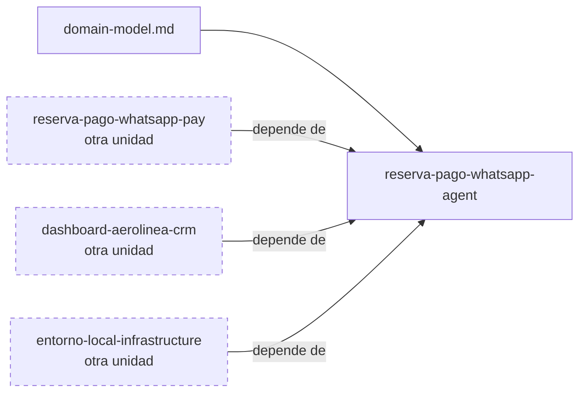

# Specs: apps/agent

> Agente conversacional que atiende la reserva y el pago de vuelos por WhatsApp.

## Grafo de specs

## Tabla de specs

| Spec | Estado | Creación | Paralelizable con | Ruta | Depende de |
|---|:---:|:---:|:---:|---|---|
| reserva-pago-whatsapp-agent | `En progreso` | `Aprobado` | `—` | `reserva-pago-whatsapp-agent/summary.md` | — |

> El modelo de dominio de la capacidad es [domain-model.md](domain-model.md); esta unidad es su dueña. Los specs de pay, crm e infrastructure dependen de este spec por contrato (ver [pay](../pay/INDEX.md), [crm](../crm/INDEX.md), [infrastructure](../infrastructure/INDEX.md)).
