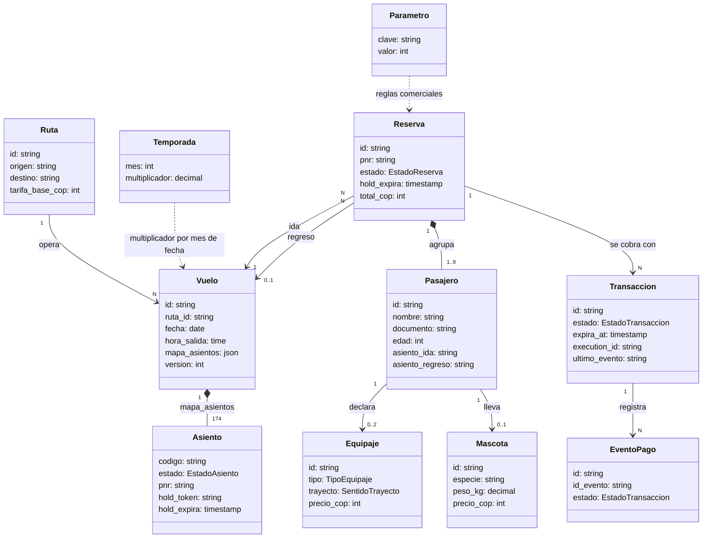

# Modelo de dominio: apps/agent (reservas y vuelos de la aerolínea DEMO)

## Resumen

Contexto delimitado (BD) de reservas y vuelos de una aerolínea DEMO que vende vuelos nacionales entre BOG, MDE, CLO y CTG por WhatsApp. Sirve al cliente que reserva y paga, a la pasarela simulada que notifica el pago y al operador que consulta ocupación. Su responsabilidad única es mantener consistente el inventario de asientos, el cálculo de precios y el ciclo de vida reserva-transacción. `apps/agent` es la unidad dueña; `apps/pay` y `apps/crm` consumen su contrato por copia verificada por hash y no tienen modelo propio. El almacén es Jelou Datum (la única DB), sin filtros, transacciones ni compare-and-set.

## Diagrama mermaid

## Glosario de lenguaje ubicuo

| Término | Definición |
|---------|-----------|
| Ruta | Trayecto dirigido `origen-destino` con tarifa base. Exactamente 6; la bidireccionalidad se modela con una fila por sentido. |
| Temporada | Multiplicador por mes del año: 1.30 en los meses 1, 6, 7 y 12; 1.00 en el resto. Se aplica por el mes de `vuelos.fecha` de cada trayecto, no por la fecha de compra. |
| Parámetro | Valor comercial u operativo por clave (12 claves). |
| Vuelo | Ruta más fecha; un vuelo por ruta y día entre 2026-12-01 y 2027-01-31 (372). Salida 07:00. Boeing 737-8 MAX, 174 asientos. |
| Mapa de asientos | JSON del vuelo con una clave por asiento; único inventario de asientos. Se escribe entero (lectura-modificación-escritura). |
| Asiento | Clave `<fila><letra>` (p. ej. `12A`) con estado LIBRE, RETENIDO, VENDIDO o BLOQUEADO. Premium: filas 1-3 (A, C, D, F); Extended: 4-7 (A-F); Economy: 8-30 (A-F). Exit row: filas 13 y 14. |
| Hold | Retención temporal de asientos: estado RETENIDO con `hold_token` y `hold_expira`. Un hold vencido equivale a LIBRE por lectura. |
| Reserva (agregado raíz) | Agrupa pasajeros, vuelo de ida, vuelo de regreso opcional y un PNR. Raíz de pasajeros, equipaje, mascota y transacciones. |
| PNR | Localizador de 6 caracteres de `[A-Z2-9]` sin O, I, 0 ni 1. |
| Pasajero | Persona de la reserva: nombre, documento (PII), edad y asientos. |
| Equipaje | De cabina (sin costo ni medidas) o de bodega (medidas y peso), por pasajero y trayecto. |
| Mascota | Animal en cabina, por pasajero; no ocupa asiento. |
| Transacción | Cobro de una reserva con su estado y el `execution_id` de la ejecución del agente a reanudar. |
| Evento de pago | Notificación de la pasarela ya registrada, identificada por `id_evento` = `<transaccion_id>:<estado>`. |
| Write-then-verify | Protocolo de escritura del mapa: escribir con `version + 1`, releer y verificar el `hold_token` o `pnr` propio; 3 intentos con backoff. |

## Entidades

- **Ruta** — entidad de referencia (seed); 6 filas.
- **Temporada** — entidad de referencia (seed); 12 filas.
- **Parámetro** — entidad de referencia (seed); 12 filas.
- **Vuelo** — entidad; contiene el mapa de asientos y su `version`.
- **Asiento** — value object dentro de `Vuelo.mapa_asientos`, sin tabla propia.
- **Reserva** — agregado raíz del ciclo de compra.
- **Pasajero** — entidad de la Reserva.
- **Equipaje** — entidad de la Reserva, ligada a un Pasajero.
- **Mascota** — entidad de la Reserva, ligada a un Pasajero.
- **Transacción** — entidad con máquina de estados; una PENDIENTE como máximo por reserva.
- **Evento de pago** — entidad de idempotencia; se registra antes de aplicar el efecto.

## Atributos

### Ruta

| Atributo | Tipo | Obligatorio |
|----------|------|-------------|
| id (`<origen>-<destino>`) | texto | Sí |
| origen (IATA, 3 letras) | texto | Sí |
| destino (IATA, 3 letras) | texto | Sí |
| tarifa_base_cop | entero | Sí |

### Temporada

| Atributo | Tipo | Obligatorio |
|----------|------|-------------|
| mes (1-12) | entero | Sí |
| multiplicador | decimal(3,2) | Sí |

### Parámetro

| Atributo | Tipo | Obligatorio |
|----------|------|-------------|
| clave | enum clave_parametro | Sí |
| valor | entero | Sí |

### Vuelo

| Atributo | Tipo | Obligatorio |
|----------|------|-------------|
| id | texto | Sí |
| ruta_id | texto (ref Ruta) | Sí |
| fecha | fecha | Sí |
| hora_salida | hora (07:00) | Sí |
| mapa_asientos | JSON (174 claves) | Sí |
| version | entero | Sí |

### Asiento (valor de `mapa_asientos`)

| Atributo | Tipo | Obligatorio |
|----------|------|-------------|
| estado | enum estado_asiento | Sí |
| pnr | texto(6) | Solo VENDIDO |
| hold_token | texto opaco | Solo RETENIDO |
| hold_expira | timestamp | Solo RETENIDO |

### Reserva

| Atributo | Tipo | Obligatorio |
|----------|------|-------------|
| id | texto | Sí |
| pnr | texto(6) | Sí |
| estado | enum estado_reserva | Sí |
| vuelo_ida_id | texto (ref Vuelo) | Sí |
| vuelo_regreso_id | texto (ref Vuelo) | No |
| hold_expira | timestamp | Sí |
| total_cop | entero | Sí |

### Pasajero

| Atributo | Tipo | Obligatorio |
|----------|------|-------------|
| id | texto | Sí |
| reserva_id | texto (ref Reserva) | Sí |
| nombre | texto | Sí |
| documento (PII) | texto | Sí |
| edad | entero | Sí |
| asiento_ida | texto | No |
| asiento_regreso | texto | No |

### Equipaje

| Atributo | Tipo | Obligatorio |
|----------|------|-------------|
| id | texto | Sí |
| pasajero_id | texto (ref Pasajero) | Sí |
| reserva_id | texto (ref Reserva) | Sí |
| tipo | enum tipo_equipaje | Sí |
| trayecto | enum sentido_trayecto | Sí |
| largo_cm, ancho_cm, alto_cm | entero | Solo BODEGA |
| peso_real_kg, peso_volumetrico_kg | decimal(6,2) | Solo BODEGA |
| precio_cop | entero | Sí |

### Mascota

| Atributo | Tipo | Obligatorio |
|----------|------|-------------|
| id | texto | Sí |
| pasajero_id | texto (ref Pasajero) | Sí |
| reserva_id | texto (ref Reserva) | Sí |
| especie | texto | Sí |
| peso_kg | decimal(5,2) | Sí |
| precio_cop | entero | Sí |

### Transacción

| Atributo | Tipo | Obligatorio |
|----------|------|-------------|
| id (`_id` asignado por Datum) | texto | Sí |
| reserva_id | texto (ref Reserva) | Sí |
| estado | enum estado_transaccion | Sí |
| expira_at | timestamp | Sí |
| execution_id | texto | No (obligatorio desde la creación por `transaccion-crear`) |
| ultimo_evento | texto | No |

### Evento de pago

| Atributo | Tipo | Obligatorio |
|----------|------|-------------|
| id | texto | Sí |
| transaccion_id | texto (ref Transacción) | Sí |
| id_evento | texto, único | Sí |
| estado | enum estado_transaccion | Sí |

## Relaciones y multiplicidad

- **Ruta** `1:N` **Vuelo** — una ruta tiene un vuelo por día de la ventana.
- **Vuelo** `1:174` **Asiento** — el mapa contiene exactamente 174 claves.
- **Reserva** `N:1` **Vuelo** (ida) y `N:0..1` **Vuelo** (regreso) — el vuelo de regreso es de la ruta inversa.
- **Reserva** `1:1..9` **Pasajero** — entre 1 y 9 pasajeros.
- **Pasajero** `1:0..2` **Equipaje** — a lo sumo una pieza de bodega por trayecto, más cabina.
- **Pasajero** `1:0..1` **Mascota** — como máximo una por reserva.
- **Reserva** `1:N` **Transacción** — a lo sumo una PENDIENTE a la vez.
- **Transacción** `1:N` **Evento de pago** — un evento por estado alcanzado.

## Reglas de negocio

- **RN-01 Tarifa**: tarifa por pasajero y trayecto = `rutas.tarifa_base_cop` × multiplicador de temporada del mes de `vuelos.fecha` (BOG-MDE y MDE-BOG 350000; BOG-CLO y CLO-BOG 380000; BOG-CTG y CTG-BOG 420000).
- **RN-02 Temporada**: 1.30 para los meses 1, 6, 7 y 12; 1.00 para el resto; se aplica a pasaje, equipaje y mascotas.
- **RN-03 Equipaje de cabina**: sin costo y sin medidas.
- **RN-04 Equipaje de bodega**: `cobrable_kg = ceil(max(peso_kg, L*A*H/6000))`; precio = `max(40000, cobrable_kg × 12000)` × temporada; L+A+H ≤ 158 cm (supuesto DEMO, GAP-17), peso ≤ 32 kg, 1 pieza por pasajero.
- **RN-05 Mascota**: máximo 1 por reserva, ≤ 8 kg, en cabina, sin asiento; precio 150000 × temporada.
- **RN-06 Asientos**: formato `12A 12B` o `12A,12B`; deben existir en el mapa, estar LIBRES y ser tantos como pasajeros; filas 13 y 14 solo con edad ≥ 15.
- **RN-07 Pago**: monto = suma de líneas (pasaje por pasajero y trayecto, equipaje, mascota), cada una redondeada con `Math.round`; se persisten `reservas.total_cop`, `equipaje.precio_cop` y `mascotas.precio_cop`.
- **RN-08 Hold**: 15 minutos; válido solo si RETENIDO y `hold_expira > ahora`; un hold vencido equivale a LIBRE por lectura. Se fija en ahora+15 min en `asientos-validar-retener`; al crear la transacción se re-fija (ver RN-09).
- **RN-09 Transacción**: PENDIENTE → APROBADA | RECHAZADA | EXPIRADA solo desde PENDIENTE; `transacciones.expira_at` = `reservas.hold_expira`; al crear la transacción (`transaccion-crear`) se re-fijan a creación+15 min, como un solo instante, `reservas.hold_expira`, `transacciones.expira_at` y el hold de los asientos del mapa (extender solo con write-then-verify); una aprobación posterior a la expiración deja la transacción EXPIRADA.
- **RN-10 Aprobación**: asientos VENDIDO con el PNR → reserva EMITIDA → transacción APROBADA → reanudar con `paid`.
- **RN-11 Rechazo**: asientos LIBRE; reserva PAGO_RECHAZADO; transacción RECHAZADA; reanudar con `rejected`.
- **RN-12 Expiración**: asientos LIBRE; reserva EXPIRADA; reanudar con `expired`.
- **RN-13 PNR**: 6 caracteres de `[A-Z2-9]` sin O, I, 0 ni 1; único por verificación de lectura antes de escribir (riesgo residual).
- **RN-14 Ventana**: toda fecha de viaje entre 2026-12-01 y 2027-01-31 inclusive.
- **RN-15 Cantidad**: entre 1 y 9 pasajeros por reserva.
- **RN-16 Idempotencia de pago**: `id_evento` = `<transaccion_id>:<estado>`, único; se registra antes de aplicar el efecto; un `id_evento` existente es duplicado y no repite el efecto (Datum no fuerza unicidad: riesgo residual).
- **RN-17 Escritura del mapa**: toda escritura usa `version + 1` y se verifica por relectura (3 intentos con backoff); si falla, 503 sin efecto parcial. No es atómico: riesgo residual de doble venta aceptado solo para DEMO.
- **RN-18 Datos personales**: nombre, documento y edad son PII; los logs enmascaran el documento.
- **RN-19 Invariantes de datos**: las de cada tabla de `apps/agent/contract/db-design.dbml` (mascota no referencia vuelos ni mapa; regreso con ruta inversa; asientos únicos por reserva y trayecto; `execution_id` presente desde la creación de la transacción).
