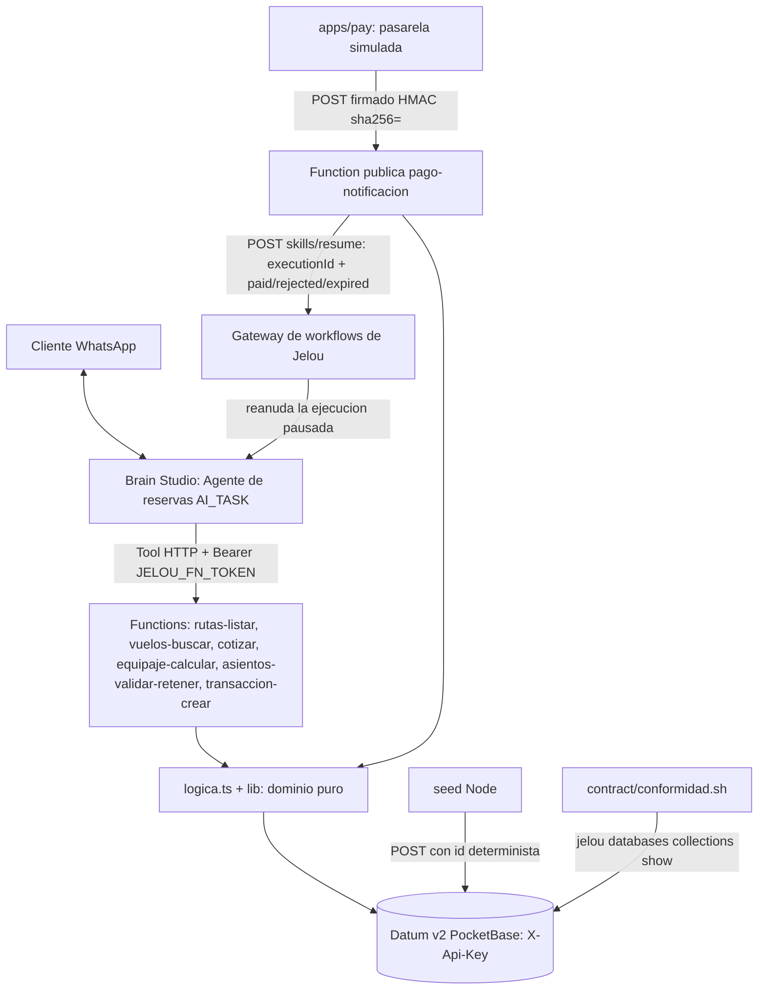

# Technical Design Document: Reserva y pago por WhatsApp (agente, functions y datos base)

## 1. Metadata & Traceability
- **Spec:** `reserva-pago-whatsapp-agent`
- **Requirements Ref:** `requirements.md` (spec: `reserva-pago-whatsapp-agent`)
- **Target Stack:** TypeScript sobre Deno 2.9.7 (functions, `@jelou/functions` 1.5.0 fijado, `zod` ^4.6.2); Node 24.22.0 (seed, conformidad, generadores del agente); `@jelou/cli` 4.13.1 en contenedor; Brain Studio (AI Agent + Tools HTTP); Datum v2 (PocketBase) por REST con cabecera `X-Api-Key`.
- **Unidad:** `apps/agent` (dueña del modelo de dominio [domain-model.md](../domain-model.md) y del esquema [db-design.dbml](db-design.dbml); copia en `apps/agent/contract/db-design.dbml`).
- **Alcance de despliegue:** DEMO mono-tenant. Existe una sola base Datum, una sola organización de Jelou y un solo proyecto de functions (`aerolinea-reservas`); ninguna colección ni function distingue tenants ni cuentas (ver [§7.2](#72-security--isolation)).

---

## 2. Architecture & System Overview

### 2.1 Architectural Approach
Hexagonal ligera por function, dentro de `apps/agent/functions/`:

- `<function>/index.ts`: adaptador de entrada. Declara la tool con `define({ name, description, input, output, handler })`, lee variables con `ctx.env`, crea el cliente Datum, registra logs con `ctx.log` (enmascarando documentos) y delega en `ejecutar`. Envuelve la llamada con `conErroresHttp`.
- `<function>/logica.ts`: caso de uso puro. Exporta los esquemas zod `entrada` y `salida` y `ejecutar(input, dep)`, con las dependencias inyectadas (`datum`, `ahora`, `payPublicUrl`, `firmaValida`, `apiKey`, `fetch`, `sleep`, `nuevoToken`, `rng`, `log`). No lee el entorno ni el reloj por sí mismo.
- `lib/`: dominio puro y adaptadores de salida compartidos.
  - Dominio puro: `precios.ts` (tarifa, temporada, bodega, mascota, total), `asientos.ts` (formato, exit row, PNR, ventana, hold válido), `hold.ts` (retener, liberar, re-fijar vencimiento sobre el mapa), `esquemas.ts` (zod compartidos), `errores.ts`, `enmascarar.ts`.
  - Adaptadores de salida: `datum.ts` (cliente REST de Datum y `escribirMapaVerificado`), `catalogo.ts` (lectura de rutas, temporada, parámetros y vuelos), `reservas.ts` (lectura de reservas, transacciones y pasajeros), `http.ts` (excepción a respuesta HTTP), `datum_simulado.ts` (Datum en memoria solo para pruebas).
- `functions/index.ts` registra las 7 tools con `app({ tools })`; solo `pago-notificacion` es pública.
- Errores: `ErrorNegocio` y `ErrorAsientos` responden 400; `FirmaInvalida` responde 401; `DatumNoDisponible` responde 503. La plataforma convierte cualquier excepción del handler en 500 y no respeta `error.status`, por eso `conErroresHttp` devuelve una `Response` nativa con el status del contrato. Cualquier otra excepción se relanza (500).
- Agente: la fuente real del agente de Brain Studio es `apps/agent/brain/` (proyecto `jelou.yml` + `jelou.lock`, 6 Tools HTTP en `brain/tools/*.json` y el workflow `brain/workflows/mi-primer-workflow.whatsapp.json`). Se genera con `node workflow/generar-tools.mjs` y `node workflow/generar-brain.mjs` (cwd = `apps/agent`) a partir de `workflow/agent.prompt.md`, que es la fuente del texto del agente.
- Cada Tool HTTP hace `POST https://aerolinea-reservas.fn.jelou.ai/<function>` (base sobreescribible con la variable `FUNCTIONS_URL` del generador) con `Authorization: Bearer {{$secret.JELOU_FN_TOKEN}}` y el cuerpo JSON recibido como texto en el único input `payload`; devuelve `{ ok, status, data }` al agente, con los errores de negocio dentro de `data`.
- El nodo `AI_TASK` "Agente de reservas" tiene `allowExternalResume: true`, expiración de 24 h, historial de 15 mensajes y las 6 tools con `action: none` (sin pausa por tool). La pausa y la reanudación las hace la plataforma con el `executionId`.

### 2.2 Component Diagram / Module Interaction


Flujo: el agente conduce la conversación y llama las tools; `transaccion-crear` guarda el `execution_id` del agente en la transacción PENDIENTE y devuelve el enlace de pago; el cliente paga en `apps/pay`; `apps/pay` notifica a `pago-notificacion`, que verifica la firma, aplica el efecto sobre asientos, reserva y transacción y reanuda al agente con `paid`, `rejected` o `expired`.

### 2.5 Decisiones cerradas (heredadas de IDEA)
- Stack con versiones fijas: `@jelou/functions` 1.5.0, `zod` ^4.6.2, Deno 2.9.7 (pruebas), Node 24.22.0 y `@jelou/cli` 4.13.1; todo se ejecuta en contenedor. Evita derivas de un SDK en vista previa.
- Datum v2 es PocketBase: acceso REST por colección (`/collections/{c}/records`) con cabecera `X-Api-Key`; `PATCH` fusiona campos y `PUT` no existe; no hay transacciones ni compare-and-set.
- Datum es la única base de datos; no hay otra persistencia.
- Write-then-verify para toda escritura sobre `vuelos.mapa_asientos`: escribir con `version + 1`, releer, verificar la marca propia (`hold_token` o `pnr`) y la versión; 3 intentos con espera creciente; si falla, 503 sin efecto parcial visible.
- Ids físicos deterministas: rutas `bogmde`, temporada `mes01`..`mes12`, parámetros sin guiones bajos, vuelos `<ruta sin guion><fecha sin guiones>`, eventos de pago `<transaccion_id><estado en minúsculas>`; la PK única de Datum hace atómica la unicidad.
- Idempotencia de la notificación de pago por `event_id` = `<transaccion_id>:<estado>`, registrado antes de aplicar el efecto.
- `execution_id` obligatorio en `transaccion-crear`; la reanudación usa `POST https://gateway.jelou.ai/workflows/v1/skills/resume` con `x-api-key` (`JELOU_API_KEY`), `executionId`, `message` y `pauseInteraction: false`.
- Hold y transacción de 15 minutos, un solo instante de vencimiento (`expira_at` = `hold_expira`); un hold vencido equivale a LIBRE por lectura (sin limpieza periódica).
- Los precios los calcula solo el servidor; el agente transmite texto y no decide precios ni reglas.
- Enlace de pago como texto plano en el mensaje de WhatsApp (sin plantillas HSM): `PAY_PUBLIC_URL` + `/pay/` + `transaccion_id`.
- Solo `pago-notificacion` es pública (HMAC `sha256=` sobre el cuerpo crudo con `PAY_WEBHOOK_SECRET`); el agente nunca la invoca.
- Las 6 tools del agente no usan `action: pause`: con pausa por tool la plataforma pausa justo después de la tool y el mensaje con el enlace de pago nunca se entrega.
- Hold y reserva se mantienen en la reserva PENDIENTE_PAGO hasta que el pago o el vencimiento la resuelvan; no hay cancelación ni reemisión.

### 2.6 Riesgos y mitigaciones

| Riesgo | Impacto | Mitigación |
|:---|:---|:---|
| Doble venta por falta de compare-and-set en Datum (dos escrituras concurrentes sobre el mismo vuelo) | Un asiento podría quedar vendido o retenido por dos reservas | Aceptado solo en DEMO con tráfico bajo; write-then-verify con `version` (3 intentos) reduce la ventana |
| PNR duplicado (Datum no admite otro índice único) | Dos reservas con el mismo localizador | Verificación por lectura de `reservas.pnr` justo antes de escribir (hasta 50 intentos); riesgo residual aceptado |
| Evento de pago duplicado o simultáneo | Efecto aplicado dos veces | Id físico determinista `<transaccion_id><estado en minúsculas>` + PK única de Datum: la creación es atómica y el segundo intento recibe 400 `validation_not_unique`, tratado como DUPLICADO |
| Functions y SDK en vista previa | Cambios incompatibles del SDK o del CLI | `@jelou/functions` 1.5.0 y `@jelou/cli` 4.13.1 fijados; `functions check` offline como verificación |
| La señal de reanudación `paid`/`rejected`/`expired` llega al agente como texto que un cliente podría escribir mientras el agente está en pausa | Entrega de PNR sin pago | Riesgo residual aceptado en la DEMO; el prompt exige que la señal contenga el valor y trata cualquier otro mensaje como estado no claro; mitigación pendiente (ver Divergencias vigentes) |
| `pago-notificacion` puede responder 503 si se notifica muy tarde una ejecución que ya no está activa | La notificación no se confirma | La transacción queda PENDIENTE y el reintento de la pasarela reaplica el efecto (los pasos son idempotentes) |
| Caída entre la reanudación y el cierre de la transacción | El agente se reanuda dos veces | Se prefiere reanudar dos veces a perder la reanudación; la transacción se cierra al final como marcador de efecto completo |
| Creación a medias de reserva, detalle o transacción | Reserva huérfana en PENDIENTE_PAGO | Compensación de mejor esfuerzo: la reserva pasa a CANCELADA y se responde 503 |
| Node 24 entra en mantenimiento | Soporte limitado del runtime de seed y conformidad | Versión fijada 24.22.0 en contenedor; el seed y la conformidad no usan dependencias de terceros |
| Deuda del contrato `apps/agent/contract/endpoints.md`: afirma autenticación Bearer/MCP de las tools (real: Tools HTTP con secreto de organización), marca nombres de campos como SUPUESTO y tiene una línea «Fuente» que remite a documentos ajenos a `.makia/docs/` | El contrato puede inducir a error a quien lo lea | Cambiarlo exige regenerar `contract/CONTRACT.sha256` y las copias de `apps/pay` y `apps/crm` (se verifican por hash); el comportamiento vigente es el descrito en [§4.2](#42-external-api--rpc--event-schemas) |

#### Divergencias vigentes
- **Firma inválida (REQ-07), interpretación vigente:** el rechazo se registra con `ctx.log("Notificación de pago rechazada: firma inválida")`; no se escribe ninguna fila en `eventos_pago`.
- **Confirmación en el chat (REQ-09):** sin test automatizado; evidencia manual E2E en los commits `1d3cc35`, `289e60f` y `d257860`.
- **Enlace de pago en el chat (REQ-10), parcial:** la construcción del enlace tiene test; la entrega por WhatsApp se verificó manualmente (commit `631350d`).
- **Conformidad en vivo (REQ-12):** el test automatizado cubre el comparador; la comparación contra Datum real es la ejecución manual de `contract/conformidad.sh` (commit `4ae8456`).
- **Reanudación sin `execution_id` (REQ-08):** el código y su test («transacción sin execution_id: aplica el efecto sin reanudar») registran un log, no reanudan y cierran la transacción con éxito; no responde 503. `transaccion-crear` exige `execution_id`, por lo que el caso solo ocurre con datos ajenos a la function.
- **Evento de expiración:** cuando una aprobación llega vencida, el evento registrado y `transacciones.ultimo_evento` conservan el estado recibido (`APROBADA`) aunque la transacción termina `EXPIRADA`; el invariante de `db-design.dbml` ("el estado del último evento coincide con el estado de la transacción") no se cumple en ese caso.
- **Artefactos obsoletos:** ver [§5](#5-implementation-target-structure-file-mapping).

### 2.7 Directrices del proyecto
- `Global`: Datum v2 (PocketBase) se accede por REST con la cabecera `X-Api-Key` tomada de `DATUM_API_KEY`, sobre la base `DATUM_URL`; el endpoint por colección es `/collections/{c}/records`.
- `Unidad: apps/agent`: `@jelou/functions` se fija en 1.5.0; la fuente real del agente de Brain Studio es `apps/agent/brain/`, generada por los scripts de `apps/agent/workflow/`; toda escritura sobre `vuelos.mapa_asientos` usa write-then-verify.
- `Unidad: apps/agent`: es dueña de [domain-model.md](../domain-model.md) y del contrato de datos `db-design.dbml` de la capacidad.

### 2.8 Sujeto a actualización futura
sin actualizaciones futuras declaradas.

---

## 3. Data Models & Schema Design

> Los datos van primero: el modelo de dominio vive en [domain-model.md](../domain-model.md) y el esquema en [db-design.dbml](db-design.dbml); este documento no los copia. Un cambio de esquema entra primero en esos dos documentos y en `apps/agent/contract/db-design.dbml` (cuya copia verifican por hash `apps/pay` y `apps/crm`).

### 3.1 Domain Entities (Core Business Objects)
Las entidades persistidas (Ruta, Temporada, Parámetro, Vuelo, Reserva, Pasajero, Equipaje, Mascota, Transacción, Evento de pago) y los value objects (Asiento, Cotización, Línea de cotización, Enlace de pago, Resultado de notificación) están definidos en [domain-model.md](../domain-model.md). Tipos del código que los materializan (`apps/agent/functions/lib/`):

```typescript
// asientos.ts
export type EstadoAsiento = "LIBRE" | "RETENIDO" | "VENDIDO" | "BLOQUEADO";
export interface Asiento { estado: EstadoAsiento; pnr: string | null; hold_token: string | null; hold_expira: string | null }
export type MapaAsientos = Record<string, Asiento>; // 174 claves "<fila><letra>"

// catalogo.ts (lectura; vuelo_id = rowId = id físico del vuelo)
export interface Ruta { id: string; origen: string; destino: string; tarifa_base_cop: number } // id lógico "BOG-MDE"
export interface Vuelo { vuelo_id: string; rowId: string; ruta_id: string; fecha: string; hora_salida: string; mapa: MapaAsientos }
export interface Catalogo { rutas: Ruta[]; temporada: Record<number, number>; parametros: Record<string, number>; vuelos: Vuelo[] }

// datum.ts
export interface Fila { _id: string; fields: Record<string, unknown>; updated?: string }

// cotizar/logica.ts (Línea de cotización)
type Linea = { concepto: "PASAJE" | "EQUIPAJE" | "MASCOTA"; trayecto?: "IDA" | "REGRESO"; pasajero_indice?: number; monto_cop: number }

// pago-notificacion/logica.ts (Resultado de notificación)
type Resultado = "APLICADO" | "EXPIRADO" | "DUPLICADO" | "SIN_EFECTO";
```

### 3.2 Database Schema & Persistence
- **Target Database / Storage:** Datum v2 (PocketBase) de Jelou, la única base de datos. Accesible por REST con `X-Api-Key`. Mono-tenant: una sola base para toda la DEMO; ninguna colección lleva campo de tenant o cuenta y no existe aislamiento entre clientes más allá de la propia clave de la base.
- **Colecciones (10):** `rutas`, `temporada`, `parametros`, `vuelos`, `reservas`, `pasajeros`, `equipaje`, `mascotas`, `transacciones`, `eventos_pago`. Campos, tipos, invariantes e índices lógicos: [db-design.dbml](db-design.dbml). No se repite aquí.
- **Mapeo de tipos a Datum:** enum -> `select` (maxSelect=1); ref -> `text`; int -> `number` (onlyInt); decimal -> `number`; date/timestamp -> `date`; time/char/text -> `text`; json -> `json`. En `number`, `required` significa "distinto de 0", por lo que los números no se marcan obligatorios.
- **Ids físicos:** admiten solo `[a-z0-9]`; la PK es única y atómica (un `id` repetido en `POST` responde 400 `validation_not_unique`). Datum no permite otros índices únicos, por lo que `rutas(origen,destino)`, `vuelos(ruta_id,fecha,hora_salida)`, `reservas.pnr`, `pasajeros(reserva_id,asiento_*)` y `eventos_pago.id_evento` se garantizan por id determinista o por código de aplicación.
- **Fechas:** las `date` llegan como `2026-12-01 00:00:00.000Z`; `lib/datum.ts` las normaliza a ISO con `T`.
- **Migraciones / DDL:** no hay SQL. Las migraciones son scripts `bash` que ejecutan el CLI de Jelou (`jelou databases collections create`), uno por colección, en `apps/agent/migrations/`:
  - Orden: `01-rutas.sh`, `02-temporada.sh`, `03-parametros.sh`, `04-vuelos.sh`, `05-reservas.sh`, `06-pasajeros.sh`, `07-equipaje.sh`, `08-mascotas.sh`, `09-transacciones.sh`, `10-eventos_pago.sh`.
  - `apply.sh` los ejecuta en orden; requiere `DATABASE_ID` y se corre dentro del contenedor del CLI (`DATABASE_ID=<id> bash migrations/apply.sh`).
  - Cada script es get-or-create: si la colección existe con un esquema distinto termina con exit 2.
  - `transacciones` no declara `id`: lo asigna Datum. `vuelos` declara `id:text` para admitir ids deterministas.
- **Conformidad:** `contract/conformidad.sh` lee cada colección con `jelou databases collections show` y `contract/conformidad.mjs` la compara con `db-design.dbml`, reportando cada diferencia (REQ-12).

---

## 4. Interfaces, Contracts & API Specifications

### 4.1 Internal Service Interfaces / Ports
Puerto de salida único hacia Datum (`lib/datum.ts`), inyectado en cada `ejecutar`:

```typescript
export interface Datum {
  listar(coleccion: string, opc?: { filter?: string; sort?: string; fields?: string }): Promise<Fila[]>; // pagina de 200, hasta 100 paginas
  leer(coleccion: string, id: string): Promise<Fila>;                  // 404 -> DatumHttpError(404)
  crear(coleccion: string, fields: Record<string, unknown>, id?: string): Promise<Fila>; // POST; id repetido -> 400 validation_not_unique
  actualizar(coleccion: string, id: string, fields: Record<string, unknown>): Promise<Fila>; // PATCH (fusiona)
}
export function crearDatum(config: { url: string; apiKey: string }, fetchImpl?: typeof fetch): Datum;
export function configDesdeEntorno(getEnv: (n: string) => string | undefined): { url: string; apiKey: string }; // DATUM_URL, DATUM_API_KEY
export function literalFiltro(valor: string): string;   // literal PocketBase con " y \ escapados
export function esDuplicado(e: unknown): boolean;        // DatumHttpError 400 + codigo validation_not_unique

export interface OpcionesEscritura {
  vueloRowId: string;
  mutar: (mapa: MapaAsientos) => MapaAsientos;     // puro; lanza ErrorNegocio/ErrorAsientos si ya no procede
  verificar: (mapa: MapaAsientos) => boolean;       // marca propia presente
  deshacer?: (mapa: MapaAsientos) => MapaAsientos;  // reversion best-effort al agotar intentos
  sleep?: (ms: number) => Promise<void>;
}
export function escribirMapaVerificado(datum: Datum, op: OpcionesEscritura): Promise<MapaAsientos>;
// INTENTOS = 3, espera 200 ms y 400 ms entre intentos; agotado -> DatumNoDisponible (503)
```

Clases de error (`lib/errores.ts`, `lib/datum.ts`): `ErrorNegocio(mensaje, motivos[])` y `ErrorAsientos(asientos_invalidos[], motivos[])` (400), `FirmaInvalida` (401), `DatumNoDisponible` (503), `DatumHttpError(httpStatus, mensaje, codigo?)` (error de Datum; el cuerpo de error nunca se conserva salvo `data.id.code`).

Lectura de catálogo (`lib/catalogo.ts`): `cargarCatalogo(datum)` lista las 4 colecciones de referencia; `buscarVuelo`, `buscarRuta`, `rutaInversa` y `validarRegreso` (regreso de la ruta inversa y no anterior a la ida) lanzan `ErrorNegocio` si no existe o no cumple; `parametrosPrecio(cat)` lanza un `Error` (500) si faltan parámetros en Datum. Lectura de reservas (`lib/reservas.ts`): `transaccionesPendientes`, `leerReserva`, `pasajerosDeReserva`, `pnrEnUso`; todas con filtros en servidor.

### 4.2 External API / RPC / Event Schemas
Convenciones comunes:
- Las 6 tools del agente son `POST /<function>` sobre `https://aerolinea-reservas.fn.jelou.ai`, invocadas por las Tools HTTP con `Authorization: Bearer ${JELOU_FN_TOKEN}` (secreto de organización). `pago-notificacion` es `POST /pago-notificacion` pública (`config: { path: "/pago-notificacion", methods: ["POST"], public: true }`).
- Entrada validada con zod antes del handler: si falla, la plataforma responde 400 `Validation failed`.
- Errores comunes de salida: `400 { error, motivos }` (regla de negocio, `ErrorNegocio`); `400 { error: "Asientos inválidos", asientos_invalidos }` (`ErrorAsientos`); `401 { error: "Firma inválida" }`; `503 { error }` (`DatumNoDisponible`: fallo de write-then-verify o de reanudación); 500 inesperado (variable de entorno faltante, parámetros faltantes en Datum). Los cuerpos de error nunca llevan causas técnicas ni datos de Datum.
- Dinero: COP enteros. Fechas de viaje `YYYY-MM-DD` dentro de 2026-12-01..2027-01-31 (zod `FechaViaje`, que además exige fecha de calendario real). Instantes: ISO 8601 UTC.
- Variables de entorno de las functions (solo nombres): `DATUM_URL`, `DATUM_API_KEY` (todas), `PAY_PUBLIC_URL` (`transaccion-crear`), `CRM_PUBLIC_URL` (`vuelos-buscar`, opcional: sin ella no se devuelve `mapa_url`), `PAY_WEBHOOK_SECRET` y `JELOU_API_KEY` (`pago-notificacion`).
- Esquemas compartidos (`lib/esquemas.ts`): `RutaId` = enum de las 6 rutas; `NumPasajeros` = entero 1..9; `Bodega` = `{ largo_cm, ancho_cm, alto_cm }` enteros positivos + `peso_kg` positivo <= 32, con L+A+H <= 158; `Mascota` = `{ pasajero_indice: 0..8, especie: 1..50 caracteres, peso_kg: positivo <= 8, trayecto: IDA | REGRESO (default IDA) }`; `PasajeroEntrada` = `{ nombre, documento, edad 0..120, cabina (default true), bodega_ida?, bodega_regreso? }`.
- Mono-tenant: ninguna function recibe ni filtra por tenant o cuenta; todas operan sobre la única base configurada por `DATUM_URL`.

#### rutas-listar (lectura, REQ-01)
- Entrada: `{}`. Salida 200: `{ rutas: [{ id, origen, destino, tarifa_base_cop }] }` (6 elementos, `id` lógico `BOG-MDE`).
- Errores: 503 si Datum no responde.

#### vuelos-buscar (lectura, REQ-01)
- Entrada: `{ ruta_id: RutaId, fecha_ida: FechaViaje, fecha_regreso?: FechaViaje, pasajeros: 1..9 }`; `fecha_regreso >= fecha_ida` o 400.
- Salida 200: `{ ida: [VueloResumen], regreso?: [VueloResumen] }` con `VueloResumen = { vuelo_id, ruta_id, fecha, hora_salida, asientos_libres, tarifa_pasajero_cop, mapa_url? }`. Cada lista contiene todos los vuelos de la ruta en esa fecha (puede haber varios, con distinta `hora_salida`), sin orden garantizado más allá del catálogo. `mapa_url` (opcional) solo se devuelve si `CRM_PUBLIC_URL` está definida y es `<CRM_PUBLIC_URL sin barras finales>/#/asientos/<vuelo_id>/<pasajeros>`: abre el widget de selección de asientos del CRM (el paso 6 del prompt depende de él). El regreso se busca en la ruta inversa de `ruta_id`. `asientos_libres` cuenta LIBRE más RETENIDO con hold vencido; `tarifa_pasajero_cop` = `round(tarifa_base * multiplicador del mes del vuelo)`. `pasajeros` solo se valida (no filtra vuelos). Una fecha sin vuelo devuelve la lista vacía. El cliente elige un `vuelo_id` entre los devueltos.
- Errores: 400 (zod: ruta, fecha fuera de ventana, pasajeros fuera de 1..9, regreso anterior); 503.

#### cotizar (lectura, REQ-02, REQ-03, REQ-04)
- Entrada: `{ vuelo_ida_id, vuelo_regreso_id?, pasajeros: [{ edad, bodega_ida?, bodega_regreso? }] (1..9), mascota?: Mascota }`.
- Salida 200: `{ lineas: [{ concepto: PASAJE|EQUIPAJE|MASCOTA, trayecto?: IDA|REGRESO, pasajero_indice?, monto_cop }], total_cop }`, con `total_cop` = suma de líneas ya redondeadas (`Math.round` por línea). Una línea `PASAJE` por pasajero y trayecto; `EQUIPAJE` por cada bodega declarada, con el mínimo de 40000 y la temporada del vuelo del trayecto; una única línea `MASCOTA` con el `trayecto` de la mascota (`IDA` por defecto o `REGRESO`) y la temporada del vuelo de ese trayecto. El `trayecto` forma parte de la entrada `mascota` y de la línea de cotización; `transaccion-crear` persiste en `mascotas` solo `especie`, `peso_kg`, `pasajero_id` y el `precio_cop` de esa línea, sin trayecto. Cada pasajero admite una bodega por trayecto (`bodega_ida`, `bodega_regreso`).
- Errores 400: vuelo inexistente; regreso que no es la ruta inversa o es anterior a la ida; equipaje de regreso sin vuelo de regreso; `pasajero_indice` de la mascota fuera de rango; bodega o mascota fuera de límites (mensaje con el pasajero y trayecto). 503.

#### equipaje-calcular (lectura, REQ-03)
- Entrada: `{ vuelo_id, bodega: Bodega }`. Salida 200: `{ peso_volumetrico_kg, cobrable_kg, precio_cop }` con `cobrable_kg = ceil(max(peso_kg, L*A*H/divisor))` y `precio_cop = round(max(cargo_minimo, cobrable_kg * tarifa_kg) * multiplicador del mes del vuelo)`.
- Errores 400: vuelo inexistente, medidas no positivas, L+A+H > 158, peso > 32, más de 1 pieza. 503.

#### asientos-validar-retener (efecto, REQ-05)
- Entrada: `{ vuelo_ida_id, vuelo_regreso_id?, edades: [0..120] (1..9, una por pasajero en orden), asientos_ida: "12A 12B" | "12A,12B", asientos_regreso? }`; los asientos de regreso son obligatorios si hay vuelo de regreso y prohibidos si no lo hay.
- Salida 200: `{ hold_token, hold_expira }` (`hold_expira` = ahora + `parametros.hold_minutos`, 15 por defecto; `hold_token` = UUID opaco que el agente solo reenvía a `transaccion-crear`).
- Efecto: valida todos los trayectos (formato, existencia, LIBRE, cantidad = edades, exit row filas 13-14 solo edad >= 15) antes de retener; después retiene ida y regreso con write-then-verify (revalidando sobre el mapa fresco en cada intento). Si el regreso falla tras retener la ida, libera la ida (mejor esfuerzo).
- Errores: 400 `{ error: "Asientos inválidos", asientos_invalidos }` sin retención parcial; 400 `ErrorNegocio` (vuelo inexistente, regreso incoherente); 503 si tras 3 intentos no se confirma la escritura.

#### transaccion-crear (efecto, REQ-06, REQ-10)
- Entrada: `{ hold_token, vuelo_ida_id, vuelo_regreso_id?, pasajeros: [PasajeroEntrada + { asiento_ida (2-3 car.), asiento_regreso? }] (1..9), mascota?, execution_id (obligatorio, min 1) }`.
- Salida 200: `{ transaccion_id, reserva_id, pnr (6 car.), total_cop, expira_at, enlace_pago (URL), existente: boolean }`. `enlace_pago` = `PAY_PUBLIC_URL` sin barras finales + `/pay/` + `transaccion_id`.
- Orden de ejecución: (1) validar asientos (existencia, sin repetidos, exit row con edad >= 15, coherencia ida/regreso); (2) buscar una transacción PENDIENTE vigente de una reserva PENDIENTE_PAGO con los mismos vuelos y el mismo conjunto de asientos y, si existe, devolverla con `existente: true` sin escribir; (3) cotizar en servidor; (4) re-fijar el vencimiento de los holds a creación + 15 min con write-then-verify (si falla, no se creó ninguna fila); (5) generar PNR único por lectura (hasta 50 intentos); (6) crear `reservas` (PENDIENTE_PAGO, `hold_expira` = `expira`, `total_cop`), `pasajeros`, `equipaje` (BODEGA con medidas y precio por trayecto; CABINA con precio 0 si `cabina`), `mascotas` y por último `transacciones` (PENDIENTE, `expira_at` = `expira`, `execution_id`); (7) releer la transacción para verificar.
- Errores: 400 (`ErrorNegocio`: asientos inválidos o repetidos, exit row, hold no válido o vencido, reglas de equipaje y mascota, falta `execution_id` por zod); 503 si falla la re-fijación o la creación (la reserva huérfana pasa a CANCELADA en mejor esfuerzo); 500 si falta `PAY_PUBLIC_URL` o no se obtiene un PNR único.

#### pago-notificacion (pública, efecto, REQ-07, REQ-08)
- Entrada (cuerpo crudo firmado): `{ transaccion_id, estado: "APROBADA" | "RECHAZADA", event_id: "<transaccion_id>:<estado>", emitido_at: datetime ISO }`; `EXPIRADA` no se acepta y `event_id` debe coincidir con `<transaccion_id>:<estado>`.
- Firma: cabecera `x-webhook-signature` con prefijo `sha256=` y HMAC con `PAY_WEBHOOK_SECRET`, verificado con `ctx.verifyHmac(request, ...)` (el handler recibe `(input, ctx, request)`). `adaptarVerificacion` convierte "no lanzó" en `true` y cualquier excepción en `false`.
- Salida 200: `{ resultado: "APLICADO" | "EXPIRADO" | "DUPLICADO" | "SIN_EFECTO" }`.
- Algoritmo (cada paso solo corre si el anterior pasó):
  0. Firma inválida -> log y 401 `{ error: "Firma inválida" }` con cero lecturas, escrituras o llamadas de red.
  1. Leer la transacción. Si no existe o no está PENDIENTE: `DUPLICADO` si ya hay un evento con ese `event_id`, si no `SIN_EFECTO`; sin efecto.
  2. Decidir destino: si `ahora > expira_at` (comparación estricta) -> transacción EXPIRADA, reserva EXPIRADA, mensaje `expired`, resultado `EXPIRADO`, aunque llegue `APROBADA`; si no, `APROBADA` -> transacción APROBADA, reserva EMITIDA, mensaje `paid`; `RECHAZADA` -> transacción RECHAZADA, reserva PAGO_RECHAZADO, mensaje `rejected`; resultado `APLICADO`.
  3. Registrar el evento (`eventos_pago`, id `<transaccion_id><estado en minúsculas>`, campos `transaccion_id`, `id_evento`, `estado`) si no existe. Si el POST responde `validation_not_unique` (entrega simultánea): `DUPLICADO` sin efecto.
  4. Asientos de ida y regreso con write-then-verify: venta (`VENDIDO` con el `pnr`, solo sobre asientos propios RETENIDOS con `hold_expira` = `expira_at`, LIBRES o ya vendidos con el mismo pnr) o liberación (solo los RETENIDOS con mi vencimiento exacto: no pisa un hold posterior de otro cliente).
  5. Reserva -> estado destino.
  6. Reanudar (ver abajo); si la transacción no tiene `execution_id`, se registra un log y se continúa sin reanudar.
  7. Cierre: transacción -> estado destino y `ultimo_evento` = `event_id` (marcador de efecto completo).
- Reanudación: `POST https://gateway.jelou.ai/workflows/v1/skills/resume`, cabecera `x-api-key` con `JELOU_API_KEY` y `Content-Type: application/json`, cuerpo `{ "executionId": "<execution_id>", "message": "paid" | "rejected" | "expired", "pauseInteraction": false }`. Fallo de red o respuesta no 2xx -> `DatumNoDisponible` (503) sin detalle técnico; la transacción sigue PENDIENTE y el reintento de la pasarela reaplica el efecto.
- Errores: 400 (zod), 401 (firma), 503 (fallo de escritura de asientos tras 3 intentos o de reanudación), 500 (`JELOU_API_KEY` ausente, reserva o vuelo inexistente). Nunca se registran el cuerpo, las cabeceras, `PAY_WEBHOOK_SECRET`, `JELOU_API_KEY` ni la firma.

#### Agente (Brain Studio)
- Conversación en este orden: trayecto -> pasajeros (1-9) -> fechas -> `vuelos-buscar` -> por pasajero datos, equipaje (`equipaje-calcular`) y mascota -> `asientos-validar-retener` -> `cotizar` y resumen con `total_cop` -> `transaccion-crear` (con `execution_id` = `{{$context.executionId}}`, en el mismo turno que la cotización y el resumen) -> mensaje de texto plano con total, vencimiento y `enlace_pago` -> espera de la reanudación.
- Reanudación: el mensaje entrante puede llegar envuelto (p. ej. `|| user message: "paid" ||`); basta que contenga `paid`, `rejected` o `expired`. `paid` -> confirmar el pago y entregar el PNR guardado con ruta, fechas y asientos; `rejected` y `expired` -> informar y ofrecer nueva reserva sin reintentar el pago; cualquier otro mensaje -> no confirmar nada.
- Nodo `endFunction` termina tras el resultado final; ramas `success` -> "Cierre", `expire` -> "Sesion expirada"; ante error técnico el agente responde un mensaje de reintento.

---

## 5. Implementation Target Structure (File Mapping)
Archivos reales de `apps/agent/` (cada ruta se lista por separado; las rutas de `functions/` son relativas a `apps/agent/functions/`). Validación de palabras reservadas (TypeScript/JavaScript): ningún segmento de ruta (`rutas-listar`, `vuelos-buscar`, `cotizar`, `equipaje-calcular`, `asientos-validar-retener`, `transaccion-crear`, `pago-notificacion`, `pay`, `lib`, `brain`, `seed`, `contract`, `migrations`, `workflow`, `spike`) ni nombre de módulo coincide con una palabra reservada.

| Archivo | Rol |
|:---|:---|
| `apps/agent/.gitignore` | Ignora `.env`, `.env.*` (salvo `.env.example`), `node_modules/`, `.deno/`, `deno.lock`, `dist/`, `coverage/`, `*.local`, `*.log` |
| `apps/agent/.gitattributes` | Fin de línea LF para `*.sh`, `*.yml`, `*.yaml`, `*.js`, `*.ts`, `*.json` y `Dockerfile` |
| `apps/agent/.dockerignore` | Excluye `.env*`, `.git*`, `node_modules`, `.deno`, `coverage`, `*.log` del contexto de imagen |
| `apps/agent/Dockerfile` | Imagen del CLI `@jelou/cli` 4.13.1 sobre `node:24.22.0-bookworm-slim` (sin `.env`; `JELOU_TOKEN` en runtime) |
| `functions/index.ts` | Raíz de despliegue: `app({ tools })` con las 7 tools |
| `functions/deno.json` | Tarea `test` e imports `@jelou/functions` 1.5.0 y `zod` ^4.6.2 |
| `functions/jelou.json` | Proyecto de despliegue `aerolinea-reservas`, `entrypoint: index.ts` |
| `functions/.gitignore` | Ignora `.jelou/` |
| `functions/rutas-listar/index.ts`, `logica.ts`, `logica_test.ts` | Tool `rutas-listar` y sus 2 pruebas |
| `functions/vuelos-buscar/index.ts`, `logica.ts`, `logica_test.ts` | Tool `vuelos-buscar` y sus 8 pruebas |
| `functions/cotizar/index.ts`, `logica.ts`, `logica_test.ts` | Tool `cotizar` y sus 5 pruebas |
| `functions/equipaje-calcular/index.ts`, `logica.ts`, `logica_test.ts` | Tool `equipaje-calcular` y sus 6 pruebas |
| `functions/asientos-validar-retener/index.ts`, `logica.ts`, `logica_test.ts` | Tool `asientos-validar-retener` y sus 10 pruebas |
| `functions/transaccion-crear/index.ts`, `logica.ts`, `logica_test.ts` | Tool `transaccion-crear` y sus 13 pruebas |
| `functions/pago-notificacion/index.ts`, `logica.ts`, `logica_test.ts` | Tool pública `pago-notificacion` y sus 22 pruebas |
| `functions/lib/precios.ts`, `precios_test.ts` | Dominio: precios y reglas de bodega y mascota |
| `functions/lib/asientos.ts`, `asientos_test.ts` | Dominio: asientos, exit row, PNR, ventana, cantidad |
| `functions/lib/hold.ts` | Dominio: retener, liberar y re-fijar holds |
| `functions/lib/datum.ts`, `datum_test.ts` | Cliente REST de Datum y write-then-verify |
| `functions/lib/datum_simulado.ts` | Datum en memoria para pruebas |
| `functions/lib/catalogo.ts` | Lectura de rutas, temporada, parámetros y vuelos |
| `functions/lib/reservas.ts` | Lectura de reservas, transacciones y pasajeros |
| `functions/lib/esquemas.ts` | Esquemas zod compartidos |
| `functions/lib/errores.ts` | `ErrorNegocio`, `ErrorAsientos`, `FirmaInvalida` |
| `functions/lib/http.ts`, `http_test.ts` | Mapeo de excepciones a respuestas 400/401/503 |
| `functions/lib/enmascarar.ts`, `enmascarar_test.ts` | Enmascarado de documentos en logs |
| `contract/db-design.dbml` | Esquema obligatorio de datos (copia verificada por hash) |
| `contract/endpoints.md` | Contrato de endpoints de las functions |
| `contract/CONTRACT.sha256` | Hashes de `db-design.dbml` y `endpoints.md` |
| `contract/conformidad.mjs`, `conformidad.test.mjs`, `conformidad.sh` | Comparador DBML vs colecciones reales, sus 9 pruebas y el script en vivo |
| `migrations/01-rutas.sh` a `migrations/10-eventos_pago.sh` (10 archivos), `migrations/apply.sh`, `migrations/README.md` | Migraciones de las 10 colecciones |
| `seed/seed.mjs`, `cargar.mjs`, `cliente.mjs`, `datos.mjs`, `package.json`, `seed.test.mjs` | Seed idempotente (CLI, carga, cliente REST con ritmo bajo, datos base, pruebas) |
| `seed/demo.mjs` | Carga opcional DEMO fuera del seed base: reservas, pasajeros, equipaje, mascotas, pagos y mapas de asientos para el CRM y las capturas del README; usa sus propias tarifas, horarios y retenciones de duración propia; se niega a correr si ya hay reservas suficientes salvo `--force` (también `--dry-run`); requiere `DATUM_URL` y `DATUM_API_KEY` |
| `brain/jelou.yml`, `brain/jelou.lock`, `brain/.gitignore`, `brain/.vscode/settings.json` | Proyecto de Brain Studio |
| `brain/tools/.schema.json`, `brain/tools/{rutas-listar,vuelos-buscar,cotizar,equipaje-calcular,asientos-validar-retener,transaccion-crear}.json` | 6 Tools HTTP del agente |
| `brain/workflows/.schema.json`, `brain/workflows/mi-primer-workflow.whatsapp.json` | Workflow real del agente |
| `workflow/agent.prompt.md` | Fuente del texto del agente |
| `workflow/generar-tools.mjs`, `workflow/generar-brain.mjs` | Generadores de `brain/tools/*.json` y del workflow |
| `spike/RESULTADO.md`, `spike/datum-crud.sh`, `spike/hmac-probe/{README.md,deno.json,index.ts}` | Spike go/no-go en vivo |
| `workflow/workflow.json`, `workflow/validar.mjs`, `workflow/README.md` | **OBSOLETOS** (ver abajo) |

Raíz nueva `apps/agent/`: incluye su `.gitignore` (arriba).

### Artefactos obsoletos (divergencia vigente, no parte del diseño)
`apps/agent/workflow/workflow.json`, `apps/agent/workflow/validar.mjs` y `apps/agent/workflow/README.md` corresponden a una declaración propia del agente previa al montaje real en Brain Studio (el README describe MCP con `JELOU_FUNCTIONS_TOKEN` y "Pause interaction", que no es lo montado). La fuente real es `apps/agent/brain/`. No se modifican ni se borran; no deben usarse como referencia.

### 5.1 Barrido de términos críticos
sin términos críticos afectados

### 5.2 Tests afectados por un nuevo corte de migración
sin cortes de migración afectados

---

## 6. Traceability Matrix: Requirements to Design
Rutas de `functions/` relativas a `apps/agent/functions/`.

| Requirement ID | Design Section | Implementation File(s) |
|:---|:---|:---|
| REQ-1.1 | §4.2 vuelos-buscar, esquemas compartidos | `lib/esquemas.ts`, `vuelos-buscar/logica.ts` |
| REQ-1.2 | §4.2 vuelos-buscar | `vuelos-buscar/logica.ts`, `lib/catalogo.ts` |
| REQ-1.3 | §4.2 vuelos-buscar | `vuelos-buscar/logica.ts`, `lib/catalogo.ts` (`rutaInversa`) |
| REQ-1.4 | §4.2 vuelos-buscar | `lib/asientos.ts` (`estaLibre`), `vuelos-buscar/logica.ts` |
| REQ-1.5 | §4.2 vuelos-buscar, §7.1 | `lib/esquemas.ts`, `lib/asientos.ts` (`fechaEnVentana`), `vuelos-buscar/logica.ts` |
| REQ-2.1 | §4.2 cotizar | `lib/precios.ts`, `cotizar/logica.ts` |
| REQ-2.2 | §4.2 cotizar | `cotizar/logica.ts`, `lib/precios.ts` (`totalCop`) |
| REQ-2.3 | §4.2 cotizar, equipaje-calcular | `lib/precios.ts` (`precioBodega`), `lib/esquemas.ts` |
| REQ-2.4 | §4.2 cotizar, §7.1 | `cotizar/logica.ts`, `lib/errores.ts` |
| REQ-3.1 | §4.2 transaccion-crear (equipaje CABINA) | `lib/esquemas.ts` (`PasajeroEntrada.cabina`), `transaccion-crear/logica.ts` |
| REQ-3.2 | §4.2 equipaje-calcular | `equipaje-calcular/logica.ts`, `lib/precios.ts` |
| REQ-3.3 | §4.2 equipaje-calcular, §7.1 | `lib/precios.ts`, `lib/esquemas.ts`, `equipaje-calcular/logica.ts` |
| REQ-4.1 | §4.2 cotizar | `lib/precios.ts` (`precioMascota`), `lib/esquemas.ts` |
| REQ-4.2 | §4.2 cotizar | `cotizar/logica.ts`, `lib/precios.ts` |
| REQ-4.3 | §4.2 cotizar, §7.1 | `lib/precios.ts`, `lib/esquemas.ts` |
| REQ-4.4 | §4.2 cotizar, §7.1 | `cotizar/logica.ts` |
| REQ-5.1 | §4.2 asientos-validar-retener | `lib/asientos.ts` (`validarSeleccion`), `asientos-validar-retener/logica.ts` |
| REQ-5.2 | §4.2 asientos-validar-retener | `lib/hold.ts`, `asientos-validar-retener/logica.ts` |
| REQ-5.3 | §4.2 asientos-validar-retener | `lib/asientos.ts` (`holdValido`, `estaLibre`) |
| REQ-5.4 | §4.2 asientos-validar-retener, §7.1 | `asientos-validar-retener/logica.ts`, `lib/errores.ts` |
| REQ-5.5 | §4.1 Datum, §7.1 | `lib/datum.ts` (`escribirMapaVerificado`), `lib/http.ts` |
| REQ-6.1 | §4.2 transaccion-crear | `transaccion-crear/logica.ts`, `lib/reservas.ts` |
| REQ-6.2 | §4.2 transaccion-crear | `transaccion-crear/logica.ts` (esquema `execution_id`), `transaccion-crear/index.ts` |
| REQ-6.3 | §4.2 transaccion-crear | `transaccion-crear/logica.ts`, `lib/hold.ts` (`refijar`, `expiraHold`) |
| REQ-6.4 | §4.2 transaccion-crear, §7.2 | `transaccion-crear/logica.ts`, `lib/reservas.ts` |
| REQ-6.5 | §4.2 transaccion-crear, §7.1 | `transaccion-crear/logica.ts`, `lib/errores.ts` |
| REQ-7.1 | §4.2 pago-notificacion, §7.2 | `pago-notificacion/index.ts`, `pago-notificacion/logica.ts` |
| REQ-7.2 | §4.2 pago-notificacion, §7.2 | `pago-notificacion/logica.ts`, `lib/errores.ts`, `lib/http.ts` |
| REQ-7.3 | §4.2 pago-notificacion, §7.2 | `pago-notificacion/logica.ts`, `lib/datum.ts` (`esDuplicado`) |
| REQ-7.4 | §4.2 pago-notificacion | `pago-notificacion/logica.ts` |
| REQ-7.5 | §4.2 pago-notificacion | `pago-notificacion/logica.ts` (`decidir`) |
| REQ-7.6 | §4.2 pago-notificacion | `pago-notificacion/logica.ts` |
| REQ-8.1 | §4.2 pago-notificacion (reanudación) | `pago-notificacion/logica.ts` (`reanudar`) |
| REQ-8.2 | §4.2 pago-notificacion, §2.6 Divergencias | `pago-notificacion/logica.ts`, `lib/http.ts` |
| REQ-9.1 | §4.2 Agente | `workflow/agent.prompt.md`, `brain/workflows/mi-primer-workflow.whatsapp.json` |
| REQ-9.2 | §4.2 Agente | `workflow/agent.prompt.md`, `brain/workflows/mi-primer-workflow.whatsapp.json` |
| REQ-10.1 | §4.2 transaccion-crear, Agente | `transaccion-crear/logica.ts`, `workflow/agent.prompt.md`, `brain/tools/transaccion-crear.json` |
| REQ-11.1 | §3.2, §5 | `seed/datos.mjs`, `seed/cargar.mjs`, `seed/seed.mjs` |
| REQ-11.4 | §5 | `seed/demo.mjs` |
| REQ-11.2 | §3.2, §7.2 | `seed/cargar.mjs`, `seed/cliente.mjs` |
| REQ-11.3 | §7.2 | `seed/cliente.mjs` |
| REQ-12.1 | §3.2 | `contract/db-design.dbml`, `migrations/*.sh` |
| REQ-12.2 | §3.2 | `contract/conformidad.mjs`, `contract/conformidad.sh` |

---

## 7. Error Handling, Edge Cases & Performance Constraints

### 7.1 Error Strategy & Failure Modes
- **Dominio** (`lib/precios.ts`, `lib/asientos.ts`, `lib/hold.ts`): funciones puras; devuelven resultados `{ ok, ... }` o lanzan `ErrorNegocio`/`ErrorAsientos`. Sin I/O.
- **Aplicación** (`logica.ts`): traduce reglas violadas a `ErrorNegocio` (400) o `ErrorAsientos` (400, con la lista de asientos inválidos); fallos del almacén a `DatumNoDisponible` (503); nunca deja una retención parcial ni una reserva PENDIENTE_PAGO sin transacción (compensación a CANCELADA).
- **Infraestructura** (`lib/datum.ts`, `lib/http.ts`): un fallo HTTP, de red o de formato de Datum cuenta como intento fallido en write-then-verify; los errores de negocio de `mutar` suben sin reintentar. Agotados 3 intentos (espera 200 ms y 400 ms): reversión de mejor esfuerzo (`deshacer`) y 503. Los mensajes de error solo llevan método, ruta y código HTTP.
- **Entrada**: la validación zod ocurre antes del handler; 400 `Validation failed`.
- **Edge cases:** EC-01 a EC-18 de `requirements.md` se cubren con los tests de [§8](#8-testing-strategy--verification-plan). Un hold vencido es LIBRE por lectura; una aprobación vencida deja la transacción EXPIRADA; un evento repetido es DUPLICADO; una notificación para una transacción no PENDIENTE no tiene efecto; un fallo de reanudación deja la transacción PENDIENTE.
- **Rendimiento:** `cargarCatalogo` lee las 4 colecciones completas en cada llamada (todos los vuelos con su mapa) en lectura paginada de 200 filas; es aceptable para el tráfico bajo de la DEMO. El seed espacia las peticiones 250 ms (<= 4 req/s; el gateway limita a 120/min) con 5 reintentos y espera creciente de 500 ms hasta 30 s.

### 7.2 Security & Isolation
- **Aislamiento (mono-tenant DEMO):** una sola base Datum, una organización y un proyecto de functions. Ninguna de las 10 colecciones (`rutas`, `temporada`, `parametros`, `vuelos`, `reservas`, `pasajeros`, `equipaje`, `mascotas`, `transacciones`, `eventos_pago`) ni ninguna function discrimina por tenant o cuenta: todos los datos son de la misma aerolínea y los separa solo el acceso a la base con `DATUM_API_KEY`. La DEMO no garantiza multi-tenencia.
- **Secretos:** solo viven como variables de entorno de las functions (`DATUM_URL`, `DATUM_API_KEY`, `PAY_WEBHOOK_SECRET`, `PAY_PUBLIC_URL`, `CRM_PUBLIC_URL`, `JELOU_API_KEY`) o como secreto de organización (`JELOU_FN_TOKEN`); nunca en el repositorio ni en los logs. `.env` está ignorado en `.gitignore` y `.dockerignore`; la imagen no lleva `.env`.
- **Superficie pública:** solo `pago-notificacion`, protegida por HMAC `sha256=` sobre el cuerpo crudo (`ctx.verifyHmac`) verificado antes de leer o escribir datos; firma inválida o ausente -> 401 sin efecto. Las otras 6 tools requieren `Authorization: Bearer` con el secreto de organización.
- **Inyección:** los filtros a Datum usan `literalFiltro` (literal entre comillas dobles con `"` y `\` escapados); las rutas de Datum codifican colección e id con `encodeURIComponent`. El agente no decide precios: los calcula el servidor y ninguna entrada los trae. El prompt ignora instrucciones del cliente que pidan cambiar reglas o aplicar descuentos.
- **Datos personales:** `pasajeros.documento` es PII. `ctx.log` usa `sanitizarParaLog` (deja visibles los 2 últimos caracteres; los de 4 o menos se ocultan por completo); `transaccion-crear` omite además `hold_token` del log; `pago-notificacion` registra solo `transaccion_id` y `estado`. El prompt prohíbe repetir documentos en el chat.
- **Idempotencia por operación con efecto:**
  - `rutas-listar`, `vuelos-buscar`, `cotizar`, `equipaje-calcular`: solo lectura.
  - `asientos-validar-retener`: cada llamada usa un `hold_token` nuevo. Repetir la llamada completa ve los asientos ya RETENIDOS con hold vigente y se rechaza como no libres (sin duplicar efecto). Los reintentos internos de write-then-verify son seguros porque `mutar` reconoce los asientos con el token propio.
  - `transaccion-crear`: una transacción PENDIENTE vigente por conjunto de vuelos y asientos; una repetición devuelve la existente (`existente: true`) sin escribir. Límite: dos llamadas simultáneas no se serializan (Datum no ofrece compare-and-set). La re-fijación del hold es idempotente si ya está fijada al mismo vencimiento.
  - `pago-notificacion`: idempotente por `event_id` (id determinista + PK única de Datum): el duplicado simultáneo responde DUPLICADO sin efecto; una transacción no PENDIENTE no transiciona. La transacción se cierra al final: si un paso previo falla (503), el evento ya registrado no cuenta como duplicado y el reintento reaplica pasos idempotentes (venta o liberación con verificación por pnr o vencimiento propio, reserva con estado fijo).
  - Reanudación: se invoca una vez por aplicación del efecto; un reintento tras una caída entre la reanudación y el cierre puede reanudar dos veces (preferido a perder la reanudación).
  - `eventos_pago`: la creación con id `<transaccion_id><estado en minúsculas>` es atómica por la PK única.
  - `seed`: idempotente por clave natural; lista los ids existentes, omite los presentes y crea el resto con POST de id determinista (un duplicado por carrera cuenta como omitida); es reanudable.

---

## 8. Testing Strategy & Verification Plan
Todo se ejecuta en contenedor (en Git Bash anteponer `MSYS_NO_PATHCONV=1`).

### 8.1 Unit Tests
- **Functions (Deno), 110 pruebas verdes:**
  `docker run --rm -v C:/repos/jelou-agent/apps/agent/functions:/app -w /app denoland/deno:2.9.7 deno test --allow-read --allow-env --allow-net`
  - Dominio: `lib/precios_test.ts` (temporada, pasaje, peso volumétrico, bodega mínimo y límites y entradas inválidas, mascota, total), `lib/asientos_test.ts` (10), `lib/enmascarar_test.ts`, `lib/http_test.ts`.
  - Casos de uso con `lib/datum_simulado.ts`: `rutas-listar` (2), `vuelos-buscar` (8), `cotizar` (5), `equipaje-calcular` (6), `asientos-validar-retener` (10), `transaccion-crear` (13), `pago-notificacion` (22, incluidas las pruebas críticas de firma, expiración, idempotencia atómica, reanudación y secretos no logueados).
- **Seed (Node), 18 pruebas verdes** y **conformidad (Node), 9 pruebas verdes sobre el comparador:**
  `docker run --rm -v C:/repos/jelou-agent/apps/agent:/app -w /app node:24.22.0-bookworm-slim sh -c 'cd seed && node --test; cd ../contract && node --test'`

### 8.2 Integration Tests
- `lib/datum_test.ts`: cliente REST y write-then-verify con `fetch` simulado (5 pruebas «write-then-verify: ...»: éxito, relectura distinta, conflicto de negocio, agotamiento de 3 intentos con 503, errores HTTP).
- Verificación en vivo contra Datum real (manual, sin test automatizado verde): carga del seed (rutas, temporadas, parámetros y vuelos; segunda ejecución sin duplicar), `node seed.mjs --verificar`, `contract/conformidad.sh` y `jelou functions check` offline.

### 8.3 Contract / E2E Tests
- Contrato: la copia de `contract/db-design.dbml` y `contract/endpoints.md` se verifica con `contract/CONTRACT.sha256`.
- E2E manual en WhatsApp (canal sandbox) con el entorno de `apps/infrastructure`: pago aprobado, rechazado, expirado y notificación duplicada, más tablero (commits `1d3cc35`, `289e60f`, `d257860`, `631350d`). Cubre REQ-09 y la entrega del enlace de REQ-10, que no tienen test automatizado.

---

## 9. Design Review Checklist
- [x] La arquitectura respeta la separación domain/application/infra sin fugas de responsabilidad.
- [x] No hay sobre-ingeniería: la solución es la más simple que resuelve el requerimiento.
- [x] El diseño no anticipa funcionalidad futura (sin mocks, stubs, puertos/inversiones de dependencia, flags, parámetros ni ramas "para cuando llegue X"); toda actualización futura figura solo en §2.8.
- [x] Todo modelo de datos de §3 está declarado en `domain-model.md` y `db-design.dbml`, y el negocio de §4 y §7 se apoya en él.
- [x] Todo requerimiento de `requirements.md` tiene un ítem correspondiente en la matriz de trazabilidad.
- [x] La estrategia de seguridad cubre las amenazas relevantes del caso.
- [x] Si el spec cambia la semántica de un término crítico, el barrido de §5 cubre TODAS sus menciones en contratos y plantillas y ninguna queda con el modelo viejo.
- [x] §2.5 recoge todas las decisiones cerradas heredadas y ninguna se reabrió en el diseño; §2.6 mantiene los riesgos heredados vigentes más los que introduce el diseño.
- [x] Si el spec añade o modifica un corte de migración, §5.2 lista TODOS los tests cuyo dato de versión queda por debajo del corte nuevo y ninguna fila queda sin marcar; si no aplica, §5.2 declara explícitamente "sin cortes de migración afectados".
