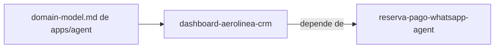

# Specs: apps/crm

> Dashboard web de solo lectura: vuelos, asientos vendidos por vuelo y destino, mapa de asientos y estadísticas de ventas.

## Grafo de specs

## Tabla de specs

| Spec | Estado | Creación | Paralelizable con | Ruta | Depende de |
|---|:---:|:---:|:---:|---|---|
| dashboard-aerolinea-crm | `En progreso` | `Aprobado` | `reserva-pago-whatsapp-pay` | `dashboard-aerolinea-crm/summary.md` | [reserva-pago-whatsapp-agent](../agent/reserva-pago-whatsapp-agent/summary.md) |

`dashboard-aerolinea-crm` es paralelizable con `reserva-pago-whatsapp-pay` porque sus footprints de archivos (`apps/crm` vs `apps/pay`) son disjuntos (confirmado). El modelo de dominio es el de apps/agent: [domain-model.md](../agent/domain-model.md).
