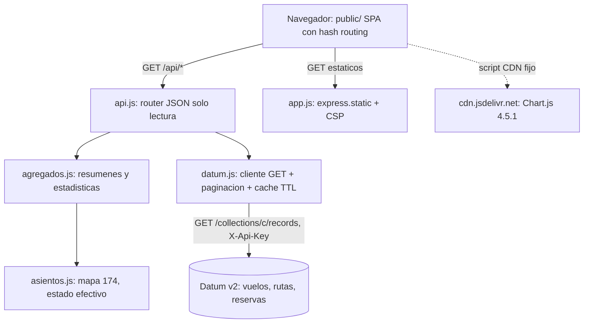

# Technical Design Document: Dashboard de la aerolínea (solo lectura)

## 1. Metadata & Traceability
- **Spec:** `dashboard-aerolinea-crm`
- **Requirements Ref:** `requirements.md` (spec: `dashboard-aerolinea-crm`)
- **Target Stack:** Node 24.22.0 (imagen `node:24.22.0-bookworm-slim`; `engines.node` = `24`), Express 5.3.0, JavaScript ESM, `node:test`; frontend estático (HTML, CSS y JavaScript con módulos ES, sin build) con Chart.js 4.5.1 desde `cdn.jsdelivr.net`.
- **Unidad:** `apps/crm`. Depende del spec [reserva-pago-whatsapp-agent](../../agent/reserva-pago-whatsapp-agent/summary.md), dueño del contrato y de los datos.
- **Estado del documento:** AS-BUILT, redactado desde el código real de `apps/crm` el 2026-10-16.

---

## 2. Architecture & System Overview

### 2.1 Architectural Approach
Servicio Node de solo lectura con tres capas finas dentro de `apps/crm/src/`:

- **domain** (`asientos.js`): mapa canónico de 174 asientos, clase y salida de emergencia por fila, estado efectivo de un asiento (RN-08), contadores por estado y porcentaje. Funciones puras, sin I/O.
- **application** (`agregados.js`): modelos de lectura derivados (resumen por vuelo, filtros, ventas por vuelo y por destino, estadísticas). Funciones puras: reciben vuelos, rutas, reservas y el instante `ahora`.
- **infra / adapters**: `datum.js` (adapter de salida: cliente HTTP de Datum v2 con solo GET, paginación y caché TTL), `api.js` (adapter de entrada: router JSON bajo `/api`), `app.js` (composición Express: cabeceras de seguridad, `/health`, `/api`, estáticos), `server.js` y `config.js` (arranque y puerto).

El instante de consulta (`now`) y el cliente Datum (`datum`) se inyectan en `createApp({ datum, now })` para que las pruebas usen un cliente simulado sin red. No hay estado propio: lo único que se conserva en memoria es la caché TTL por colección del cliente Datum. El frontend (`public/`) es una SPA estática que consume solo los endpoints `GET /api/*`.

### 2.2 Component Diagram / Module Interaction


### 2.5 Decisiones cerradas (heredadas de IDEA)
- El panel es de solo lectura; ninguna operación escribe en Datum (cliente sin métodos de escritura).
- Ocupación = vendidos / 174; un hold vencido cuenta como libre por lectura (RN-08, RN-17), sin depender de limpieza.
- Chart.js 4.5.1 por CDN fijo (`cdn.jsdelivr.net`) como único origen externo permitido.
- Sin autenticación del operador: DEMO local, mono-tenant.
- El contrato de datos de `apps/agent` se consume por copia verificada por hash, sin desvío.
- Acceso a Datum v2 (PocketBase): `GET {DATUM_URL}/collections/{coleccion}/records` con cabecera `X-Api-Key`.

### 2.6 Riesgos y mitigaciones

| Riesgo | Impacto | Mitigación |
|:---|:---|:---|
| Lectura completa de colecciones en el servidor (`vuelos`, `rutas`, `reservas`; 372 vuelos con su `mapa_asientos`) en cada cálculo | Latencia y carga sobre Datum al crecer los datos | Caché TTL en memoria por colección (10 s por defecto, `CRM_CACHE_TTL_MS`), con deduplicación de lecturas concurrentes; colecciones pequeñas en la DEMO |
| Dependencia de CDN para Chart.js | Sin conexión a `cdn.jsdelivr.net` los gráficos no se dibujan | Versión fijada (4.5.1); la UI detecta `window.Chart` ausente y muestra un aviso textual; tablas y mapa siguen funcionando |
| Sin autenticación del dashboard | Cualquiera con acceso al puerto ve ocupación e ingresos | Es DEMO local; el contenedor se publica solo en `127.0.0.1` en los comandos documentados; no sin protección en un servicio abierto |
| Retraso de unos segundos por la caché | Una venta puede tardar hasta el TTL en reflejarse | Aceptado (requirements, restricciones operativas); TTL configurable |
| Declaración de Node distinta entre unidades: `package.json` y Dockerfile de crm usan `24` en `engines` mientras `pay` fija 24.22.0 | Posible desalineación de versión entre unidades | La imagen de crm usa `node:24.22.0-bookworm-slim`; solo `engines.node` queda en la línea mayor 24 (nota de consistencia) |
| `mapa_asientos` corrupto o con claves ausentes | Conteos erróneos | Una clave ausente o con estado desconocido se reporta `BLOQUEADO` (no vendible); un mapa que no sea objeto se trata como vacío |

### 2.7 Directrices del proyecto
Sin directrices nuevas.

### 2.8 Sujeto a actualización futura
Sin actualizaciones futuras declaradas.

---

## 3. Data Models & Schema Design

> `apps/crm` no tiene modelo de dominio ni base de datos propios. El modelo de dominio único de la capacidad es [domain-model.md](../../agent/domain-model.md) (dueña: `apps/agent`) y el esquema es `apps/agent/contract/db-design.dbml` (copia verificada en `apps/crm/contract/db-design.dbml` y en [db-design.dbml](../../agent/reserva-pago-whatsapp-agent/db-design.dbml)). Este spec solo define modelos de lectura derivados, no persistidos. Mono-tenant DEMO: no hay aislamiento por inquilino.

### 3.1 Domain Entities (Core Business Objects)

**Colecciones que crm lee (solo lectura):**

| Colección | Campos que usa crm | Uso |
|:---|:---|:---|
| `vuelos` | `id` (id físico, p. ej. `bogmde20261201`), `ruta_id` (ruta lógica, p. ej. `BOG-MDE`), `fecha`, `hora_salida`, `mapa_asientos` (JSON: clave `<fila><letra>`, valor `{estado, pnr, hold_token, hold_expira}`) | Resumen por vuelo, mapa, ventas |
| `rutas` | `id`, `origen`, `destino` | Origen y destino de cada vuelo |
| `reservas` | `estado`, `total_cop` | Conteo por estado e ingresos (suma de `total_cop` de las EMITIDA) |

crm no lee `pasajeros`, `equipaje`, `mascotas`, `transacciones` ni `eventos_pago`, y no devuelve nombre, documento ni edad (RN-18). `hold_token` nunca se copia a una respuesta.

**Reglas de dominio aplicadas (de [domain-model.md](../../agent/domain-model.md) y los requirements):**
- Clase por fila: Premium filas 1 a 3 (letras A, C, D, F; 12 asientos), Extended filas 4 a 7 (A a F; 24), Economy filas 8 a 30 (A a F; 138). Total 174. Salida de emergencia: filas 13 y 14.
- Estado efectivo (RN-08): un asiento RETENIDO cuyo `hold_expira` es menor o igual que el instante de consulta cuenta como LIBRE; un RETENIDO vigente no es venta. Estado ausente o fuera de `LIBRE | RETENIDO | VENDIDO | BLOQUEADO` se reporta `BLOQUEADO`.
- Ocupación % = `round(vendidos / total * 1000) / 10` (una decimal); `total` = 174 por vuelo (o `vuelos * 174` en agregados).

**Modelos de lectura derivados (no persistidos):**

```typescript
type EstadoAsiento = 'LIBRE' | 'RETENIDO' | 'VENDIDO' | 'BLOQUEADO';
type Clase = 'PREMIUM' | 'EXTENDED' | 'ECONOMY';

interface ResumenVuelo {            // elemento de GET /api/vuelos
  vuelo_id: string; ruta: string;   // ruta = vuelos.ruta_id
  origen: string | null; destino: string | null;
  fecha: string;                    // YYYY-MM-DD
  hora_salida: string | null;
  total_asientos: 174;
  libres: number; retenidos: number; vendidos: number; bloqueados: number;
  ocupacion_pct: number;
}

interface AsientoDetalle {          // elemento de GET /api/vuelos/:id/asientos
  asiento: string; fila: number; letra: string; clase: Clase;
  exit_row: boolean; estado: EstadoAsiento;
  pnr: string | null;               // solo si estado === 'VENDIDO'
}
```

### 3.2 Database Schema & Persistence
- **Target Database / Storage:** ninguno propio. Fuente: Jelou Datum v2 (PocketBase), accedido solo por lectura. Estado en memoria: caché TTL por colección en el cliente Datum (se pierde al reiniciar).
- **Migrations / DDL:** no aplica; el esquema pertenece a `apps/agent` (`db-design.dbml`).
- **Normalización de filas (`datum.js`):** cada fila se aplana a los campos del dominio; se eliminan los metadatos de PocketBase (`collectionId`, `collectionName`, `created`, `updated`, `expand`), se conserva `id` (id físico) y se añade el alias `_id` igual a `id`; las fechas `2026-12-01 00:00:00.000Z` (espacio) se convierten a ISO con `T`.
- **`mapa_asientos`:** puede llegar como objeto o como cadena JSON; `leerMapa` acepta ambos.

---

## 4. Interfaces, Contracts & API Specifications

### 4.1 Internal Service Interfaces / Ports

```typescript
// src/datum.js — adapter de salida (solo lectura)
createDatumClient({ env = process.env, fetchFn = fetch }): {
  list(coleccion: string): Promise<Fila[]>;          // todas las páginas, con caché TTL
  getById(coleccion: string, id: string): Promise<Fila | null>;  // 404 -> null
}
class DatumNoConfigurado extends Error {}            // falta DATUM_URL o DATUM_API_KEY
class DatumError extends Error {}                    // red, HTTP no OK, cuerpo inválido

// src/app.js
createApp({ datum = createDatumClient(), now }): Express   // no escucha; server.js llama listen
// src/api.js
createApi({ datum, now = () => new Date() }): express.Router
// src/asientos.js
estadoEfectivo(entrada, ahora), detalleAsientos(vuelo, ahora), contarEstados(vuelo, ahora), porcentaje(parte, total)
// src/agregados.js
resumirVuelos(vuelos, rutas, ahora), filtrarVuelos(resumen, {ruta, desde, hasta}),
ventasPorVuelo(resumen), ventasPorDestino(resumen), estadisticas(resumen, reservas, ahora)
// src/config.js
resolvePort(env): number    // PORT_CRM entero 1..65535, si no 3000
```

**Cliente Datum (contrato real):**
- Configuración leída del entorno en cada llamada: `DATUM_URL` (base, se recortan barras finales) y `DATUM_API_KEY` (cabecera `X-Api-Key`, más `Accept: application/json`). Si falta alguna, se lanza `DatumNoConfigurado` antes de tocar la caché o la red.
- Único punto de red: `GET` con tiempo máximo de 8 s (`AbortSignal.timeout`). Red caída o tiempo agotado -> `DatumError('Datum no disponible')`; HTTP 404 -> `null` (en `list` se convierte en `DatumError`); otro HTTP no OK -> `DatumError('Datum respondio <status>')`; cuerpo no JSON -> `DatumError`. Los mensajes de error no incluyen cabeceras, cuerpo ni clave.
- Paginación: `GET {base}/collections/{coleccion}/records?page=N&perPage=100`, desde la página 1 hasta `totalPages` (límite de seguridad de 200 páginas); se detiene si una página llega vacía o `totalPages` no es numérico. Una respuesta sin arreglo `items` es inválida (`DatumError`).
- Caché: por colección, `{at, promise}`; vigencia `CRM_CACHE_TTL_MS` (entero >= 0; por defecto 10000 ms; 0 desactiva la reutilización). Se guarda la promesa, por lo que lecturas concurrentes comparten una sola petición; un fallo se elimina de la caché. `getById` no usa caché.
- El objeto devuelto solo expone `list` y `getById` (ambos GET): no existe método de escritura.

### 4.2 External API / RPC / Event Schemas

Todas las rutas son `GET`. Prefijo `/api` salvo `/health`. Todas las respuestas bajo `/api` llevan `Cache-Control: no-store`. Los errores bajo `/api` son siempre `{ "error": "<codigo>" }`.

**`GET /health`**
- 200 `{ "status": "ok" }`. No consulta Datum.

**`GET /api/vuelos`**
- Parámetros de consulta opcionales (se combinan con AND): `ruta` (igualdad exacta con `ruta`, p. ej. `BOG-MDE`), `desde` (`fecha >= desde`), `hasta` (`fecha <= hasta`); fechas con formato `YYYY-MM-DD`.
- 200: `{ "vuelos": ResumenVuelo[] }` ordenado por `fecha` y luego `ruta`.
  ```json
  { "vuelos": [ { "vuelo_id": "bogmde20261201", "ruta": "BOG-MDE", "origen": "BOG", "destino": "MDE",
      "fecha": "2026-12-01", "hora_salida": "07:00", "total_asientos": 174,
      "libres": 165, "retenidos": 3, "vendidos": 5, "bloqueados": 1, "ocupacion_pct": 2.9 } ] }
  ```
- 400 `fecha_invalida` si `desde` o `hasta` no es una cadena `YYYY-MM-DD`; 400 `ruta_invalida` si `ruta` no es una cadena (p. ej. repetida).

**`GET /api/vuelos/:id/asientos`**
- `:id` se compara con `id` o `_id` del vuelo.
- 200:
  ```json
  { "vuelo_id": "bogmde20261201", "ruta": "BOG-MDE", "fecha": "2026-12-01",
    "resumen": { "total_asientos": 174, "libres": 165, "retenidos": 3, "vendidos": 5, "bloqueados": 1, "ocupacion_pct": 2.9 },
    "asientos": [ { "asiento": "1A", "fila": 1, "letra": "A", "clase": "PREMIUM", "exit_row": false, "estado": "VENDIDO", "pnr": "ABC234" } ] }
  ```
  `asientos` siempre trae los 174 en el orden canónico (fila, letra). `pnr` solo se informa en asientos VENDIDO (código de reserva; no es dato personal) y es `null` en el resto. `hold_token` y `hold_expira` no se incluyen.
- 404 `vuelo_no_encontrado` si ningún vuelo coincide.

**`GET /api/ventas/por-vuelo`**
- 200: `{ "total_vendidos": number, "vuelos": [ { "vuelo_id", "ruta", "fecha", "vendidos" } ] }` (mismo orden que `/api/vuelos`, sin filtros).

**`GET /api/ventas/por-destino`**
- 200: `{ "destinos": [ { "destino", "vuelos", "vendidos", "total_asientos", "ocupacion_pct" } ] }`, ordenado por `vendidos` descendente y luego `destino`. `vuelos` = número de vuelos del destino; `total_asientos` = `vuelos * 174`; `ocupacion_pct` = `vendidos / total_asientos`.

**`GET /api/estadisticas`**
- 200:
  ```json
  { "generado_at": "2026-12-01T12:00:00.000Z", "vuelos": 372,
    "asientos": { "total": 64728, "vendidos": 0, "retenidos": 0, "libres": 0, "bloqueados": 0 },
    "ocupacion_pct": 0,
    "reservas_por_estado": { "PENDIENTE_PAGO": 0, "EMITIDA": 0, "PAGO_RECHAZADO": 0, "EXPIRADA": 0, "CANCELADA": 0 },
    "ingresos_cop": 0,
    "top_rutas": [ { "ruta": "BOG-MDE", "origen": "BOG", "destino": "MDE", "vendidos": 0 } ],
    "serie_vendidos_por_fecha": [ { "fecha": "2026-12-01", "vendidos": 0 } ] }
  ```
  `ingresos_cop` = suma de `total_cop` de las reservas EMITIDA; `reservas_por_estado` inicia en 0 las cinco claves y suma cualquier otro estado que aparezca; `top_rutas` = las 5 rutas con más vendidos (desempate por ruta); `serie_vendidos_por_fecha` ordenada por fecha. (Los valores numéricos del ejemplo son ilustrativos de la forma.)

**Errores transversales de `/api`**
- 405 `metodo_no_permitido` (cabecera `Allow: GET, HEAD, OPTIONS`) para cualquier método distinto de GET, HEAD y OPTIONS, en cualquier subruta de `/api`, antes de tocar Datum.
- 404 `no_encontrado` para una ruta `/api/*` inexistente.
- 503 `datum_no_configurado` si falta `DATUM_URL` o `DATUM_API_KEY`.
- 502 `datum_no_disponible` para cualquier otro fallo del almacén o del cálculo, sin detalles ni la clave.

**Estáticos y arranque**
- `GET /` y archivos de `public/` mediante `express.static`; cualquier otra ruta no `/api` responde 404 (no hay fallback a `index.html`; el enrutado de la SPA es por hash).
- `server.js` escucha en `0.0.0.0:<PORT_CRM|3000>`; en `SIGTERM` cierra el servidor y las conexiones inactivas y termina con código 0.

**Cabeceras de seguridad (todas las respuestas, incluidas `/health` y estáticos)**
- `Content-Security-Policy`: `default-src 'self'; script-src 'self' https://cdn.jsdelivr.net; style-src 'self'; img-src 'self' data:; connect-src 'self'; object-src 'none'; base-uri 'self'; frame-ancestors 'none'`.
- `X-Content-Type-Options: nosniff`, `Referrer-Policy: no-referrer`; `X-Powered-By` deshabilitado.

**Frontend (`public/`)**
- `index.html` carga `https://cdn.jsdelivr.net/npm/chart.js@4.5.1/dist/chart.umd.min.js` con `defer` y `/js/main.js` como módulo; solo `<div id="app">`. Sin atributos `style` ni `<style>`: los valores dinámicos (barra de ocupación) usan `style.setProperty` de variables CSS vía `h({vars})`.
- `dom.js`: constructor `h(tag, attrs, ...hijos)`; los datos entran siempre con `textContent`/nodos de texto (ningún `innerHTML`).
- `api.js` (cliente): `fetch` con el verbo por defecto (GET) a `/api/estadisticas`, `/api/vuelos`, `/api/ventas/por-vuelo`, `/api/ventas/por-destino`, `/api/vuelos/<id>/asientos`; los errores se envuelven en `ApiError(codigo, status)` (`red` si falla el fetch). El frontend no envía filtros al servidor: descarga `/api/vuelos` completo y filtra y ordena en cliente con la misma semántica (`aplicarFiltros`, `ordenar`).
- Routing por hash (`hash.js`): `#/resumen`, `#/vuelos`, `#/mapa` y `#/mapa/<vuelo_id>`, `#/ventas`; cualquier otro hash cae en `resumen`. `main.js` construye el shell (navegación, botón refrescar, interruptor de auto-refresco cada 15 s sin pestaña oculta, cambio de idioma), carga en paralelo estadísticas, vuelos y ventas (y el mapa si la vista es `mapa`), conserva los últimos datos si un refresco falla (aviso de datos obsoletos) y evita refrescos solapados.
- Vistas (`views/`): `resumen.js` (KPI de vuelos, vendidos, retenidos, libres, ocupación e ingresos; chips de reservas por estado; gráficos de ocupación global, por destino, vendidos por fecha, rutas destacadas y reservas por estado), `vuelos.js` (filtros ruta, desde y hasta; tabla ordenable con barra de ocupación; gráfico; clic abre el mapa), `ventas.js` (gráficos y tablas por destino y por vuelo), `mapa.js` (selector de vuelo, fuselaje con cabinas, bloques 2+2 en Premium y 3+3 en Extended y Economy, banner y marcas de salida en filas 13 y 14, contadores por estado y por clase, panel de detalle del asiento, navegación con flechas).
- `seatmap-layout.js`: layout puro de 174 asientos (`construirLayout`, `validarLayout`, `contarPorEstado`, `contarPorClase`, `vecino`); `charts.js`: envoltorio de Chart.js con aviso si `window.Chart` no existe; `ui.js`: estados cargando, vacío y error con reintento (mensajes específicos para `datum_no_configurado` y `red`).
- i18n (`i18n.js`): catálogos `es` y `en` con las mismas claves; idioma inicial desde `localStorage` (`crm-lang`) o `navigator.language` (español por defecto); `t(clave, params)` con interpolación `{param}`. `format.js`: `formatCOP` (COP sin decimales), `formatInt`, `formatPct` (el valor llega en escala 0-100, hasta una decimal), `formatFecha` (UTC, sin desfase de zona) y `formatHace`, con locales `es-CO` y `en-US`.

---

## 5. Implementation Target Structure (File Mapping)

Raíz: `apps/crm/` (unidad nueva). Estructura: `src/` (domain, application y adapters), `public/` (frontend), `tests/`, `contract/` (copia del contrato).

| Archivo | Capa / rol | Tareas |
|:---|:---|:---|
| `apps/crm/.gitignore` | Entradas del stack (`.env`, `node_modules/`) | 2.14 |
| `apps/crm/.gitattributes` | Normalización de fin de línea (`eol=lf`) | 2.14 |
| `apps/crm/package.json` | Dependencia `express` 5.3.0, `engines.node` 24, scripts `start` y `test` | 2.14 |
| `apps/crm/package-lock.json` | Lockfile npm usado por `npm ci` en el Dockerfile | 2.14 |
| `apps/crm/src/config.js` | Resolución de `PORT_CRM` (defecto 3000) | 2.14 |
| `apps/crm/src/app.js` | Composición Express: cabeceras, `/health`, `/api`, estáticos | 2.14 |
| `apps/crm/src/server.js` | Arranque, `listen` en `0.0.0.0`, apagado con `SIGTERM` | 2.14 |
| `apps/crm/src/datum.js` | Adapter de salida: cliente Datum solo GET, paginación, caché TTL | 2.15 |
| `apps/crm/src/api.js` | Adapter de entrada: router `/api` de solo lectura y errores | 2.15 |
| `apps/crm/src/agregados.js` | Application: resumen por vuelo, filtros, ventas y estadísticas | 2.15 |
| `apps/crm/src/asientos.js` | Domain: mapa canónico de 174, estado efectivo, contadores | 2.15 |
| `apps/crm/public/index.html` | Documento HTML, carga de Chart.js 4.5.1 y `main.js` | 2.16 |
| `apps/crm/public/styles.css` | Estilos (temas claro y oscuro, mapa de asientos, tablas) | 2.16 |
| `apps/crm/public/js/main.js` | Shell, enrutado, refresco, idioma | 2.16 |
| `apps/crm/public/js/api.js` | Cliente de `/api/*` (solo GET) | 2.16 |
| `apps/crm/public/js/dom.js` | Constructor de DOM seguro | 2.16 |
| `apps/crm/public/js/hash.js` | Parseo del hash de navegación | 2.16 |
| `apps/crm/public/js/i18n.js` | Catálogos es/en, `t`, idioma inicial | 2.16 |
| `apps/crm/public/js/format.js` | Formateadores COP, enteros, porcentaje, fechas | 2.16 |
| `apps/crm/public/js/charts.js` | Envoltorio de Chart.js | 2.16 |
| `apps/crm/public/js/ui.js` | Estados cargando, vacío y error | 2.16 |
| `apps/crm/public/js/seatmap-layout.js` | Layout de 174 asientos y contadores | 2.16 |
| `apps/crm/public/js/views/resumen.js` | Vista Resumen | 2.16 |
| `apps/crm/public/js/views/vuelos.js` | Vista Vuelos | 2.16 |
| `apps/crm/public/js/views/ventas.js` | Vista Ventas | 2.16 |
| `apps/crm/public/js/views/mapa.js` | Vista Mapa de asientos | 2.16 |
| `apps/crm/Dockerfile` | Imagen `node:24.22.0-bookworm-slim`, usuario 1000:1000, HEALTHCHECK Node | 2.17 |
| `apps/crm/.dockerignore` | Excluye `tests`, `contract`, `*.md` y `node_modules` de la imagen | 2.17 |
| `apps/crm/README.md` | Variables, contrato Datum, comandos Docker | 2.15, 3.6 |
| `apps/crm/contract/CONTRACT.sha256` | Huellas SHA-256 de la copia del contrato | 1.3 |
| `apps/crm/contract/verify-contract.sh` | Verificación de hash e identidad con el original | 1.3 |
| `apps/crm/contract/db-design.dbml` | Copia del esquema de `apps/agent` | 1.3 |
| `apps/crm/contract/endpoints.md` | Copia del contrato de endpoints de `apps/agent` | 1.3 |
| `apps/crm/tests/fixtures.js` | Fixtures y cliente Datum simulado | 2.15 |
| `apps/crm/tests/api.test.js` | Endpoints `/api`, privacidad, 405, 502, 503 | 2.15 |
| `apps/crm/tests/datum.test.js` | Cliente Datum | 2.15 |
| `apps/crm/tests/server.test.js` | `/health`, estáticos, cabeceras, puerto | 2.14 |
| `apps/crm/tests/frontend.test.js` | Lógica pura del frontend (layout, formatos, hash, filtros, i18n) | 2.16 |
| `apps/crm/tests/static.test.js` | HTML, CSP, sin estilos inline ni `innerHTML`, solo GET | 2.16 |

El Dockerfile copia solo `package*.json`, `src/` y `public/` (`tests`, `contract` y `*.md` quedan fuera de la imagen por `.dockerignore`).

### 5.1 Barrido de términos críticos
Sin términos críticos afectados.

### 5.2 Tests afectados por un nuevo corte de migración
Sin cortes de migración afectados.

---

## 6. Traceability Matrix: Requirements to Design

| Requirement ID | Design Section | Implementation File(s) |
|:---|:---|:---|
| REQ-01 (REQ-1.1 a REQ-1.6) | §3.1 estado efectivo y ocupación; §4.2 `GET /api/vuelos`, `/api/ventas/por-vuelo`, `/api/ventas/por-destino` | `src/asientos.js`, `src/agregados.js`, `src/api.js`, `public/js/views/vuelos.js`, `public/js/views/ventas.js` |
| REQ-02 (REQ-2.1 a REQ-2.5) | §3.1 mapa canónico; §4.2 `GET /api/vuelos/:id/asientos`; §4.2 Frontend (mapa) | `src/asientos.js`, `src/api.js`, `public/js/seatmap-layout.js`, `public/js/views/mapa.js` |
| REQ-03 (REQ-3.1 a REQ-3.4) | §4.2 `GET /api/estadisticas`; §4.2 Frontend (formatos) | `src/agregados.js`, `src/api.js`, `public/js/format.js`, `public/js/views/resumen.js`, `public/js/i18n.js` |
| REQ-04 (REQ-4.1 a REQ-4.5) | §4.1 cliente Datum; §4.2 errores 405, 502, 503; §7.1 y §7.2 | `src/datum.js`, `src/api.js`, `public/js/api.js` |
| REQ-05 (REQ-5.1 a REQ-5.4) | §4.2 `/health`, cabeceras, arranque y frontend; §7.2 | `src/config.js`, `src/app.js`, `src/server.js`, `public/index.html`, `public/js/dom.js`, `Dockerfile` |
| REQ-06 (REQ-6.1, REQ-6.2) | §3 (esquema consumido por copia); §8.3 | `contract/CONTRACT.sha256`, `contract/verify-contract.sh`, `contract/db-design.dbml`, `contract/endpoints.md` |

---

## 7. Error Handling, Edge Cases & Performance Constraints

### 7.1 Error Strategy & Failure Modes
- **Domain/application:** funciones puras que no lanzan por datos faltantes: clave ausente o estado desconocido -> `BLOQUEADO`; `hold_expira` no parseable en un RETENIDO se mantiene RETENIDO; `fecha` nula -> cadena vacía; `ruta_id` sin ruta registrada deriva origen y destino del propio `ruta_id` (`BOG-MDE`).
- **Adapter de entrada (`api.js`):** validación de parámetros (400) y mapeo único de errores: `DatumNoConfigurado` -> 503 `datum_no_configurado`; cualquier otro error -> 502 `datum_no_disponible`, sin mensaje, traza ni clave. Un `:id` desconocido -> 404 `vuelo_no_encontrado`.
- **Adapter de salida (`datum.js`):** todo fallo se traduce a `DatumError` con mensaje genérico; no hay reintentos; un fallo no se cachea.
- **Frontend:** `ApiError` -> panel de error con reintento; si ya hay datos, se conservan y se muestra un aviso de datos obsoletos. Sin Chart.js, aviso textual en cada gráfico.
- **Rendimiento:** cálculo en memoria por solicitud sobre las colecciones en caché (TTL 10 s por defecto); `/api/vuelos/:id/asientos` lee solo `vuelos`. No se define SLA.

### 7.2 Security & Isolation
- **Solo lectura:** el cliente Datum solo expone GET; el router rechaza con 405 todo método fuera de GET, HEAD y OPTIONS antes de consultar el almacén; el frontend no declara otro verbo (verificado por `static.test.js`).
- **Privacidad (RN-18):** no se leen pasajeros; `hold_token` y `hold_expira` no se copian; `pnr` solo aparece en asientos VENDIDO.
- **Secretos:** `DATUM_URL` y `DATUM_API_KEY` solo del entorno (`${DATUM_URL}`, `${DATUM_API_KEY}`); nunca se registran ni aparecen en errores o respuestas. El contenedor no los incluye en la imagen (se pasan con `-e`).
- **XSS / inyección:** CSP con `script-src 'self' https://cdn.jsdelivr.net`, `style-src 'self'`, `object-src 'none'`, `frame-ancestors 'none'`; sin estilos inline ni `innerHTML`/`insertAdjacentHTML`/`document.write`/`eval`; todos los datos entran como texto. El `:id` y la colección se codifican con `encodeURIComponent` al construir la URL de Datum; las fechas del filtro se validan con expresión regular.
- **Aislamiento:** contenedor sin root (`USER 1000:1000`), `x-powered-by` deshabilitado, publicación recomendada solo en `127.0.0.1`. Sin autenticación: DEMO mono-tenant, no exponer como servicio abierto.
- **Idempotencia:** todas las operaciones de §4 son lecturas (GET/HEAD/OPTIONS) sin efecto de lado y naturalmente idempotentes: repetirlas no cambia datos ni inventario. La caché solo reutiliza resultados dentro del TTL y no altera el almacén. No hay operación reintentable con efecto.

---

## 8. Testing Strategy & Verification Plan

Verificado el 2026-10-16: 47 pruebas verdes en `apps/crm`.

### 8.1 Unit Tests
- `tests/frontend.test.js` (lógica pura del frontend): layout de 174 asientos, bloques 2+2 y 3+3, salida en filas 13-14, coincidencia con el mapa canónico del servidor, `validarLayout`, contadores por estado y clase, navegación con flechas, formateadores COP, enteros y porcentaje (es-CO y en-US), fechas en UTC, `formatHace`, hash routing, filtros y orden de vuelos, catálogos i18n con claves idénticas y todas las claves usadas definidas.
- `tests/datum.test.js` (9): normalización de filas, paginación con `X-Api-Key` y solo GET, página vacía y respuesta sin `items`, caché TTL (TTL 0 desactiva), fallo no cacheado, `getById`, red caída sin filtrar el secreto, sin configuración sin llamadas de red, cliente sin métodos de escritura.

### 8.2 Integration Tests
- `tests/api.test.js` (14): con el cliente simulado de `tests/fixtures.js` (holds vencidos y vigentes, bloqueados, rutas y reservas por estado): mapa canónico, `GET /api/vuelos` (contadores, ocupación, filtros), asientos (174, clase, exit row, estado efectivo, 404), ventas por vuelo y por destino, estadísticas, ningún endpoint filtra `hold_token`, 405 para métodos de escritura, 503 sin configuración (incluido `createApp` sin dependencias), 502 sin filtrar detalles y ninguna escritura recibida por el cliente simulado.
- `tests/server.test.js` (5): `/health`, estáticos, 404, cabeceras de seguridad, puerto por defecto 3000 y `PORT_CRM`.
- `tests/static.test.js` (7): HTML con Chart.js 4.5.1 exacto y `defer`, único origen externo `cdn.jsdelivr.net`, tipos MIME de assets, sin estilos inline, sin inserción de HTML, sin verbos distintos de GET y formas de respuesta que consume el frontend.

### 8.3 Contract / E2E Tests
- Contrato: `sh apps/crm/contract/verify-contract.sh` (equivale a `sha256sum -c CONTRACT.sha256` y compara con `apps/agent/contract`). No es una prueba `node:test` versionada; se ejecuta por comando.
- Dashboard en vivo con el seed cargado (372 vuelos) y E2E con Docker Compose: tareas 3.6 y 4.1 (ver `tasks.md`).

**Comandos (todo en contenedor; en Git Bash anteponer `MSYS_NO_PATHCONV=1`):**

```sh
docker run --rm -v C:/repos/jelou-agent/apps/crm:/src:ro node:24.22.0-bookworm-slim sh -c 'mkdir /w && cd /src && tar cf - --exclude=./node_modules . | tar xf - -C /w && cd /w && npm ci && npm test'
docker build -t crm C:/repos/jelou-agent/apps/crm
docker run --rm -p 127.0.0.1:3000:3000 -e DATUM_URL -e DATUM_API_KEY crm
```

---

## 9. Design Review Checklist
- [x] La arquitectura respeta la separación domain/application/infra sin fugas de responsabilidad.
- [x] No hay sobre-ingeniería: la solución es la más simple que resuelve el requerimiento.
- [x] El diseño no anticipa funcionalidad futura (sin mocks, stubs, puertos/inversiones de dependencia, flags, parámetros ni ramas "para cuando llegue X"); toda actualización futura figura solo en §2.8.
- [x] Todo modelo de datos de §3 está declarado en `domain-model.md` y `db-design.dbml`, y el negocio de §4 y §7 se apoya en él.
- [x] Todo requerimiento de `requirements.md` tiene un ítem correspondiente en la matriz de trazabilidad.
- [x] La estrategia de seguridad cubre las amenazas relevantes del caso.
- [x] Si el spec cambia la semántica de un término crítico, el barrido de §5 cubre TODAS sus menciones en contratos y plantillas y ninguna queda con el modelo viejo (no aplica: sin términos críticos afectados).
- [x] §2.5 recoge todas las decisiones cerradas y ninguna se reabrió en el diseño; §2.6 mantiene los riesgos vigentes más los que introduce el diseño.
- [x] Si el spec añade o modifica un corte de migración, §5.2 lista TODOS los tests cuyo dato de versión queda por debajo del corte nuevo (no aplica: §5.2 declara "sin cortes de migración afectados").
- [ ] REQ-06 cuenta con una prueba `node:test` versionada (divergencia declarada: la verificación del hash se ejecuta por comando, no forma parte de `npm test`).
