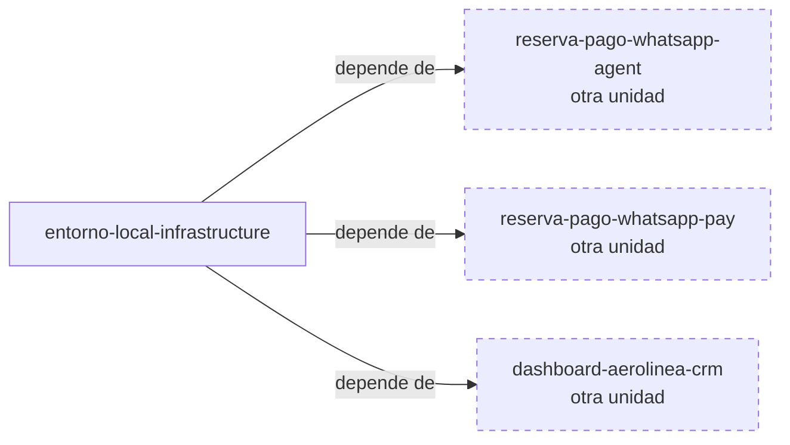

# Specs: apps/infrastructure

> Entorno local que levanta y conecta todos los servicios de la reserva y el pago de vuelos por WhatsApp.

## Grafo de specs

## Tabla de specs

| Spec | Estado | Creación | Paralelizable con | Ruta | Depende de |
|---|:---:|:---:|:---:|---|---|
| entorno-local-infrastructure | `En progreso` | `Creado — pendiente aprobación` | `—` | `entorno-local-infrastructure/summary.md` | [reserva-pago-whatsapp-agent](../agent/reserva-pago-whatsapp-agent/summary.md), [reserva-pago-whatsapp-pay](../pay/reserva-pago-whatsapp-pay/summary.md), [dashboard-aerolinea-crm](../crm/dashboard-aerolinea-crm/summary.md) |

> Unidad de arranque sin modelo de dominio propio (el de la capacidad está en [domain-model.md](../agent/domain-model.md)); se construye al final porque integra las imágenes de las otras unidades.
