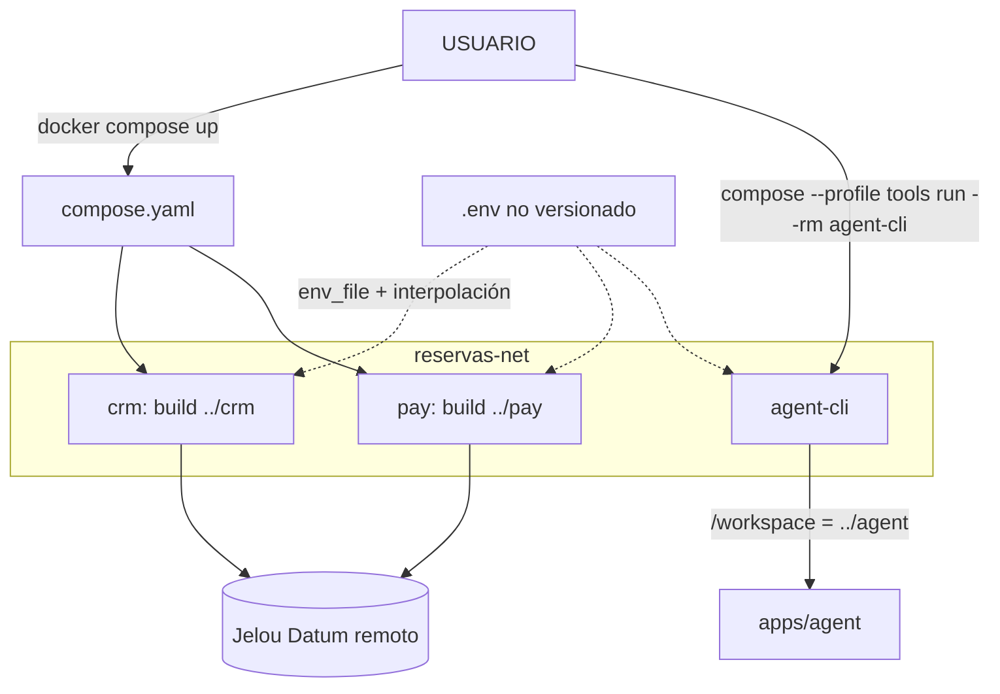

# Technical Design Document: Entorno local de la aerolínea DEMO (Docker Compose)

## 1. Metadata & Traceability
- **Spec:** `entorno-local-infrastructure`
- **Requirements Ref:** `requirements.md` (spec: `entorno-local-infrastructure`)
- **Target Stack:** Docker Compose v2 (proyecto `aerolinea-reservas-whatsapp`), archivo `.env` local, `.gitattributes` y `.gitignore` de la unidad. Las imágenes que compose construye son Node 24 (`node:24.22.0-bookworm-slim`).

---

## 2. Architecture & System Overview

### 2.1 Architectural Approach
`apps/infrastructure` es una unidad de arranque: no contiene código de producto ni modelo de dominio propio. Su único artefacto ejecutable es `compose.yaml`, que orquesta tres servicios construidos desde las otras unidades:

| Servicio | Build context | Perfil | Puerto publicado | Healthcheck |
|:---|:---|:---|:---|:---|
| `crm` | `../crm` | (por defecto) | `127.0.0.1:${PORT_CRM:-3000}:${PORT_CRM:-3000}` | Node `fetch` a `http://127.0.0.1:<PORT_CRM>/health` (intervalo 30s, timeout 5s, start_period 10s, 3 reintentos) |
| `pay` | `../pay` | (por defecto) | `127.0.0.1:${PORT_PAY:-3001}:${PORT_PAY:-3001}` | Node `fetch` a `http://127.0.0.1:<PORT_PAY>/health` (intervalo 10s, timeout 3s, start_period 5s, 3 reintentos) |
| `agent-cli` | `../agent` | `tools` | ninguno | ninguno |

Reglas del diseño:
- Nombre de proyecto fijo `name: aerolinea-reservas-whatsapp`; una sola red `reservas-net` a la que se unen los tres servicios.
- Sin contenedor de base de datos: la base de datos es Jelou Datum, remota. Sin `depends_on`: `crm` y `pay` no se llaman entre sí (cada uno habla con Datum).
- Todos los servicios usan `init: true`; `crm` y `pay` usan `restart: unless-stopped`.
- `env_file` apunta a `.env` con `required: false`: compose arranca sin ese archivo, y las variables sin valor por defecto quedan vacías (ver §7.1).
- Los puertos se publican únicamente en `127.0.0.1`, con el número tomado de `.env` (`PORT_CRM`, `PORT_PAY`) y por defecto 3000 y 3001. El mismo número se usa dentro y fuera del contenedor.
- `agent-cli` no arranca con `docker compose up`; se invoca bajo demanda con `docker compose --profile tools run --rm agent-cli <comando>`. Monta `../agent` en `/workspace`, de modo que nada se instala en el host.

### 2.2 Component Diagram / Module Interaction

Variables que `compose.yaml` inyecta a cada servicio (solo nombres):

| Servicio | Variables en `environment` |
|:---|:---|
| `crm` | `PORT_CRM`, `DATUM_URL`, `DATUM_API_KEY`, `DATUM_BASE_URL` (opcional, vacío por defecto), `CRM_CACHE_TTL_MS` (opcional, vacío por defecto) |
| `pay` | `PORT_PAY`, `DATUM_URL`, `DATUM_API_KEY`, `PAY_WEBHOOK_SECRET`, `PAGO_NOTIFICACION_URL`, `PAY_PUBLIC_URL`, `DATUM_BASE_URL` (opcional, vacío por defecto) |
| `agent-cli` | `JELOU_TOKEN`, `JELOU_PROJECT_ID` (opcional), `DATABASE_ID` (opcional), `DATABASE_SLUG` (opcional) |

`JELOU_API_KEY` y `JELOU_FUNCTIONS_TOKEN` figuran en `.env.example` pero `compose.yaml` no las declara en `environment`; como `env_file` carga `.env` completo en cada servicio, llegan al contenedor si están definidas en `.env`.

### 2.5 Decisiones cerradas (heredadas de IDEA)
- El nombre del proyecto compose deriva del identificador de la idea (`aerolinea-reservas-whatsapp`), para que los recursos Docker queden agrupados y reconocibles.
- Los números de puerto salen de `.env`, no de valores fijos en `compose.yaml`, para que el USUARIO resuelva un conflicto de puertos sin editar otros archivos.
- La contenedorización es obligatoria, incluido el CLI de Jelou: nada se instala en el host salvo el motor de contenedores.
- No hay contenedor de base de datos: los datos viven únicamente en Jelou Datum.
- Los secretos existen solo como nombre de variable; los valores viven en `.env`, no versionado.
- Cada unidad con archivos de texto versionados declara `.gitattributes` con `eol=lf`.

### 2.6 Riesgos y mitigaciones

| Riesgo | Impacto | Mitigación |
|:---|:---|:---|
| `PAY_PUBLIC_URL` es `http://localhost:3001`: el enlace de pago apunta a la máquina local | El enlace solo abre en la máquina del USUARIO, no en un teléfono u otro dispositivo (EC-23) | Limitación declarada de la demo; el E2E abre el enlace desde la misma máquina |
| Windows y CRLF en archivos versionados | Fallo difícil de diagnosticar al arrancar contenedores con scripts o YAML con CRLF | `.gitattributes` con `eol=lf` y verificación con `git ls-files --eol` |
| El E2E real depende de credenciales y de un canal de WhatsApp propios del USUARIO | Sin ellos no puede reproducirse el recorrido; el envío desde un teléfono real no está verificado | Se verificó el canal sandbox; el USUARIO debe conectar el canal o agregar su teléfono como probador (EC-22) |
| Variables obligatorias vacías o ausentes en `.env` | Un servicio puede arrancar con configuración incompleta | Plantilla `.env.example` con todos los nombres y README con la tabla de variables; el healthcheck no detecta variables vacías (ver §7.1) |

### 2.7 Directrices del proyecto
- **Global:** el nombre del proyecto compose deriva del identificador de la idea (`aerolinea-reservas-whatsapp`).
- **Global:** los puertos de los servicios se definen en `.env` y se publican solo en `127.0.0.1`.
- **Global:** el CLI de Jelou se ejecuta siempre en contenedor (perfil `tools`); no se instala nada en el host.
- **Global:** los secretos se documentan solo como nombre de variable; los valores viven en `.env`, no versionado.
- **Unidad: apps/infrastructure:** cada unidad declara su propio `.gitattributes` con `eol=lf`.

### 2.8 Sujeto a actualización futura
sin actualizaciones futuras declaradas

---

## 3. Data Models & Schema Design

> Los datos van primero: esta unidad no tiene modelo de datos ni base de datos propios. El modelo de dominio único de la capacidad es [domain-model.md](../../agent/domain-model.md) (dueña: `apps/agent`) y se referencia solo como contexto; el esquema obligatorio es `apps/agent/contract/db-design.dbml`.

### 3.1 Domain Entities (Core Business Objects)
No aplica: la unidad no define entidades. Las entidades de la reserva (vuelos, asientos, reservas, transacciones) pertenecen a `apps/agent` y las consumen `crm` y `pay`.

### 3.2 Database Schema & Persistence
- **Target Database / Storage:** ninguno propio. Los datos residen en Jelou Datum (servicio remoto); `crm` y `pay` lo acceden con `DATUM_URL` y `DATUM_API_KEY`.
- **Migrations / DDL:** ninguna en esta unidad. Las migraciones y el seed se ejecutan desde `apps/agent` con `agent-cli`, que recibe `DATABASE_ID` y `DATABASE_SLUG`.

---

## 4. Interfaces, Contracts & API Specifications

### 4.1 Internal Service Interfaces / Ports
Contratos de `compose.yaml`:

| Contrato | Definición |
|:---|:---|
| Proyecto | `name: aerolinea-reservas-whatsapp` |
| Red | `reservas-net` (única) |
| Servicios por defecto | `crm`, `pay` (`docker compose up`) |
| Servicio bajo demanda | `agent-cli`, perfil `tools` |
| Entrada de configuración | `.env` (opcional para compose, requerido para operar), con plantilla `.env.example` |
| Salida observable | estado `healthy` de `crm` y `pay` en `docker compose ps` |

Variables de `.env.example` (solo nombres): `PORT_CRM`, `PORT_PAY`, `JELOU_TOKEN`, `JELOU_API_KEY`, `PAY_WEBHOOK_SECRET`, `PAY_PUBLIC_URL`, `CRM_PUBLIC_URL`, `PAGO_NOTIFICACION_URL`, `JELOU_FUNCTIONS_TOKEN`, `JELOU_PROJECT_ID`, `DATUM_URL`, `DATUM_API_KEY`, `DATABASE_ID`, `DATABASE_SLUG`; opcionales y comentadas: `DATUM_BASE_URL`, `CRM_CACHE_TTL_MS`. Solo los puertos (3000, 3001), `PAY_PUBLIC_URL` (`http://localhost:3001`), `CRM_PUBLIC_URL` (`http://localhost:3000`) y `PAGO_NOTIFICACION_URL` (URL pública de la función de notificación) traen valor; ninguno es sensible. `CRM_PUBLIC_URL` no la consume `compose.yaml`: es una variable de las functions en Jelou (`vuelos-buscar` arma con ella el enlace al selector de asientos del CRM) y el README la documenta.

### 4.2 External API / RPC / Event Schemas
- **Endpoint / Event Name:** `GET /health` de `crm` (puerto `PORT_CRM`) y de `pay` (puerto `PORT_PAY`), usado por el healthcheck de cada servicio. Éxito: respuesta HTTP `ok`; cualquier otra respuesta o error de conexión hace fallar la comprobación (salida 1).
- **Comando de arranque:** `docker compose up --build -d` desde `apps/infrastructure`; luego `docker compose ps` hasta ver `healthy`.
- **Comando del CLI bajo demanda:** `docker compose --profile tools run --rm agent-cli <comando>` (p. ej. `--help`, `functions check`).
- **Validación de configuración:** `docker compose --env-file .env.example config -q`.
- **README de arranque:** `apps/infrastructure/README.md` documenta los servicios, la preparación de `.env` (`cp .env.example .env`), la tabla de variables y el servicio que las consume, el arranque, el apagado (`docker compose down`), el CLI y la seguridad.
- **Error States:** no hay API propia; los fallos se manifiestan como contenedor `unhealthy`, fallo de enlace de puerto ocupado o fallo de build (ver §7.1).

---

## 5. Implementation Target Structure (File Mapping)

| Archivo | Propósito |
|:---|:---|
| `apps/infrastructure/compose.yaml` | Servicios `crm`, `pay`, `agent-cli`; red `reservas-net`; puertos en loopback; healthchecks; perfil `tools` |
| `apps/infrastructure/.env.example` | Plantilla pública con los nombres de variable, sin valores sensibles |
| `apps/infrastructure/.gitattributes` | Reglas `eol=lf` para `*.sh`, `*.yaml`, `*.js`, `*.ts` y `Dockerfile` |
| `apps/infrastructure/.gitignore` | Excluye `.env` y `.env.*`, con excepción de `.env.example` |
| `apps/infrastructure/README.md` | Guía de arranque del USUARIO |
| `apps/infrastructure/MIGRAR-CUENTA.md` | Guía para replicar el entorno en otra cuenta de Jelou; enlazada desde el README |
| `apps/infrastructure/docs/` | Capturas del chat de WhatsApp (`capturas/`) y `asientos-avion.webp`, usadas por el README del repositorio |

### 5.1 Barrido de términos críticos
sin términos críticos afectados

### 5.2 Tests afectados por un nuevo corte de migración
sin cortes de migración afectados

---

## 6. Traceability Matrix: Requirements to Design
| Requirement ID | Design Section | Implementation File(s) |
|:---|:---|:---|
| REQ-1.1 | §2.1 (puertos en loopback desde `.env`), §4.1 | `apps/infrastructure/compose.yaml` |
| REQ-1.2 | §2.1 (healthchecks), §4.2 | `apps/infrastructure/compose.yaml`, `apps/infrastructure/README.md` |
| REQ-1.3 | §2.1 (perfil `tools`), §4.2 | `apps/infrastructure/compose.yaml`, `apps/infrastructure/README.md` |
| REQ-1.4 | §2.1 (nombre de proyecto, red, sin DB) | `apps/infrastructure/compose.yaml` |
| REQ-1.5 | §7.1 | `apps/infrastructure/compose.yaml`, `apps/infrastructure/.env.example`, `apps/infrastructure/README.md` |
| REQ-2.1 | §2.2 (variables por servicio), §7.2 | `apps/infrastructure/compose.yaml` |
| REQ-2.2 | §4.1 (variables de `.env.example`) | `apps/infrastructure/.env.example`, `apps/infrastructure/README.md` |
| REQ-2.3 | §4.2 (arranque), §2.1 (`env_file`) | `apps/infrastructure/compose.yaml`, `apps/infrastructure/README.md` |
| REQ-2.4 | §7.2 | `apps/infrastructure/.gitignore` |
| REQ-3.1 | §7.2, §8.1 | `apps/infrastructure/.gitattributes` |
| REQ-3.2 | §7.2 | `apps/infrastructure/.gitattributes` |
| REQ-3.3 | §8.1 | `apps/infrastructure/.gitattributes` |
| REQ-4.1 | §8.1 (verificación de hash; el contrato pertenece a `apps/agent`) | (sin archivo propio; verificación por comando sobre `CONTRACT.sha256` de cada unidad) |
| REQ-4.2 | §8.1 | (verificación por comando) |
| REQ-4.3 | §8.1 | (verificación por comando) |
| REQ-5.1 | §8.3 | `apps/infrastructure/compose.yaml` (entorno del E2E) |
| REQ-5.2 | §8.3 | `apps/infrastructure/compose.yaml` |
| REQ-5.3 | §8.3 | `apps/infrastructure/compose.yaml` |
| REQ-5.4 | §8.3 | `apps/infrastructure/compose.yaml` |
| REQ-5.5 | §8.3 | `apps/infrastructure/compose.yaml` |
| REQ-5.6 | §8.3, §2.6 | `apps/infrastructure/README.md` |

---

## 7. Error Handling, Edge Cases & Performance Constraints

### 7.1 Error Strategy & Failure Modes
- **Variable obligatoria ausente (EC-19):** `compose.yaml` no usa la sintaxis de variable obligatoria (`${VAR:?}`) para las credenciales; una variable sin definir se interpola vacía. El healthcheck solo consulta `/health`, que responde `ok` sin validar la configuración: un servicio con credenciales vacías puede quedar `healthy` y responder error de configuración en sus consultas (p. ej. `crm` responde `503 datum_no_configurado`). La defensa es la plantilla `.env.example` que enumera todos los nombres y la tabla de variables del README. Un servicio con `restart: unless-stopped` que no logra arrancar se reinicia y es visible en `docker compose ps` y `docker compose logs`.
- **Puerto ocupado (EC-20):** el enlace del puerto de host falla al crear el contenedor y compose lo informa; el USUARIO cambia `PORT_CRM` o `PORT_PAY` en `.env`.
- **Servicio no saludable:** el healthcheck devuelve salida 1 si `/health` no responde `ok` o la conexión falla; tras 3 reintentos el estado pasa a `unhealthy`.
- **CRLF (EC-21):** `.gitattributes` evita el CRLF al clonar o guardar y `git ls-files --eol` lo detecta.
- **Canal de WhatsApp no conectado o teléfono no habilitado (EC-22):** no pertenece a esta unidad; el recorrido de prueba requiere que el USUARIO conecte el canal o agregue su teléfono como probador.
- **Interrupción del arranque:** repetir `docker compose up` es seguro: los datos residen en Datum, no en los contenedores.

### 7.2 Security & Isolation
- **Secretos:** solo existen como nombre de variable en `compose.yaml`, `.env.example` y el README. Los valores viven en `apps/infrastructure/.env`, ignorado por `apps/infrastructure/.gitignore` (`.env` y `.env.*`, con excepción de `.env.example`). `.env.example` solo trae valores no secretos.
- **Exposición local:** los puertos se publican solo en `127.0.0.1`; los servicios no son accesibles desde otras máquinas. `agent-cli` no publica puertos.
- **Usuario no root en las imágenes que construye compose:** los Dockerfile de `apps/crm` (`USER 1000:1000`), `apps/pay` (`USER node`) y `apps/agent` (`USER node`) ejecutan el proceso sin privilegios de root.
- **Fin de línea:** `.gitattributes` con `eol=lf` evita que CRLF rompa scripts o YAML dentro de los contenedores.
- **Idempotencia por operación con efecto:**

| Operación | Mecanismo |
|:---|:---|
| `docker compose up` / `up --build -d` | Idempotente: compose reconcilia el estado deseado; repetirlo no duplica servicios ni redes y solo recrea lo que cambió |
| `docker compose down` | Idempotente: repetirlo sobre un proyecto ya detenido no tiene efecto adicional |
| `docker compose --profile tools run --rm agent-cli <comando>` | El contenedor se elimina al terminar (`--rm`); la repetición depende del comando del CLI (por ejemplo, `functions check` es de solo lectura y offline) |
| `docker compose config`, `ps` | Solo lectura |

---

## 8. Testing Strategy & Verification Plan

Esta unidad no tiene suite automatizada versionada. Se verifica con comandos deterministas y con un recorrido de punta a punta manual con evidencia.

### 8.1 Unit Tests
No hay pruebas unitarias ni suite automatizada en esta unidad. Resultados de los comandos de verificación ejecutados por TEST el 2026-10-16, todos con código de salida 0:

| Comando | Cubre | Resultado |
|:---|:---|:---|
| `docker compose --profile tools config --services` (desde `apps/infrastructure`) | REQ-1.2, REQ-1.3, REQ-1.4 | Lista `agent-cli`, `crm` y `pay` |
| `git check-ignore -v apps/infrastructure/.env` | REQ-2.1, REQ-2.4 | Ignorado por `apps/infrastructure/.gitignore`; `.env` no versionado |
| `git ls-files --eol` sobre `*.sh`, `*.yaml`, `*.yml`, `*.js` y `Dockerfile` bajo `apps/` | REQ-3.1, REQ-3.3 | 54 archivos, 0 con `i/crlf` (en el E2E eran 53: cambió el conjunto de archivos versionados, no es un fallo) |
| `sha256sum -c CONTRACT.sha256` en `apps/agent`, `apps/pay` y `apps/crm`; comparación de `db-design.dbml` y `endpoints.md` | REQ-4.1, REQ-4.2 | OK en las tres unidades; las tres copias de `db-design.dbml` y de `endpoints.md` tienen el mismo sha256 |
| Revisión de `apps/infrastructure/.env.example` | REQ-2.2 | Solo trae valores no secretos (puertos 3000/3001, `PAY_PUBLIC_URL` `http://localhost:3001`, `CRM_PUBLIC_URL` `http://localhost:3000` y `PAGO_NOTIFICACION_URL` pública); el resto vacío |

### 8.2 Integration Tests
No hay pruebas de integración automatizadas. La integración de `crm` y `pay` con Datum y la del agente con `pay` se validan en el recorrido de §8.3. La comprobación de salud de `crm` y `pay` en `docker compose ps` (estado `healthy`) se verificó en ese recorrido.

### 8.3 Contract / E2E Tests
Recorrido manual con evidencia, ejecutado el 2026-10-16 con `docker compose up` (Tarea 4.1; commits 1d3cc35, 289e60f, d257860, 631350d):
- Ida y vuelta BOG-MDE 2026-12-10/14, 2 pasajeros, asientos 12A/12B, 1 maleta de bodega y 1 perro: total COP 2.639.000; asientos RETENIDO a VENDIDO con PNR, reserva EMITIDA, transacción APROBADA (REQ-5.1).
- Rechazada: asiento 14A LIBRE, reserva PAGO_RECHAZADO (REQ-5.2).
- Expiración (15 minutos reales): asientos LIBRE, reserva EXPIRADA, el agente avisa (REQ-5.3).
- Duplicada: respuesta 200 DUPLICADO; RECHAZADA tras APROBADA: SIN_EFECTO (REQ-5.4).
- Dashboard crm: 6 vendidos e ingresos COP 3.549.000, igual a la suma de las 3 reservas EMITIDA (REQ-5.5).
- Reverificación independiente por canal sandbox de WhatsApp (`jelou test send`): total COP 2.483.000, aprobar con PNR, rechazar con asientos libres, expiración con asientos libres, duplicada con DUPLICADO.
- Datos de prueba eliminados; seed con su contenido base.

**Divergencia:** el recorrido no está automatizado como script versionado. No se verificó el envío real de un mensaje desde un teléfono por WhatsApp (solo el canal sandbox), ni la cotización de la mascota en la vuelta (se cotiza solo en la ida), ni las respuestas 503 y 422 al notificar muy tarde una ejecución inactiva. La señal de reanudación al agente viaja como texto.

---

## 9. Design Review Checklist
- [x] La arquitectura respeta la separación domain/application/infra sin fugas de responsabilidad. (La unidad solo orquesta; no contiene dominio ni aplicación.)
- [x] No hay sobre-ingeniería: la solución es la más simple que resuelve el requerimiento.
- [x] El diseño no anticipa funcionalidad futura (sin mocks, stubs, puertos/inversiones de dependencia, flags, parámetros ni ramas "para cuando llegue X"); toda actualización futura figura solo en §2.8.
- [x] Todo modelo de datos de §3 está declarado en `domain-model.md` y `db-design.dbml`, y el negocio de §4 y §7 se apoya en él. (§3 declara que la unidad no tiene modelo propio y referencia el modelo de `apps/agent`.)
- [x] Todo requerimiento de `requirements.md` tiene un ítem correspondiente en la matriz de trazabilidad.
- [x] La estrategia de seguridad cubre las amenazas relevantes del caso.
- [x] Si el spec cambia la semántica de un término crítico, el barrido de §5 cubre TODAS sus menciones en contratos y plantillas y ninguna queda con el modelo viejo. (No aplica: §5.1 declara que no hay términos críticos afectados.)
- [x] §2.5 recoge todas las decisiones cerradas heredadas y ninguna se reabrió en el diseño; §2.6 mantiene los riesgos heredados vigentes más los que introduce el diseño.
- [x] Si el spec añade o modifica un corte de migración, §5.2 lista TODOS los tests cuyo dato de versión queda por debajo del corte nuevo y ninguna fila queda sin marcar; si no aplica, §5.2 declara explícitamente "sin cortes de migración afectados".
