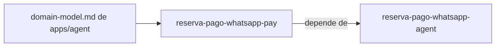

# Specs: apps/pay

> Pasarela de pago simulada: muestra el monto de la reserva, permite aprobar o rechazar y notifica el resultado firmado al agente.

## Grafo de specs

## Tabla de specs

| Spec | Estado | Creación | Paralelizable con | Ruta | Depende de |
|---|:---:|:---:|:---:|---|---|
| reserva-pago-whatsapp-pay | `En progreso` | `Creado — pendiente aprobación` | `dashboard-aerolinea-crm` | `reserva-pago-whatsapp-pay/summary.md` | [reserva-pago-whatsapp-agent](../agent/reserva-pago-whatsapp-agent/summary.md) |

Paralelizable con `dashboard-aerolinea-crm` porque los footprints de archivos (apps/pay vs apps/crm) son disjuntos (confirmado). El modelo de dominio es el de apps/agent ([domain-model.md](../agent/domain-model.md)); esta unidad no tiene otro.
