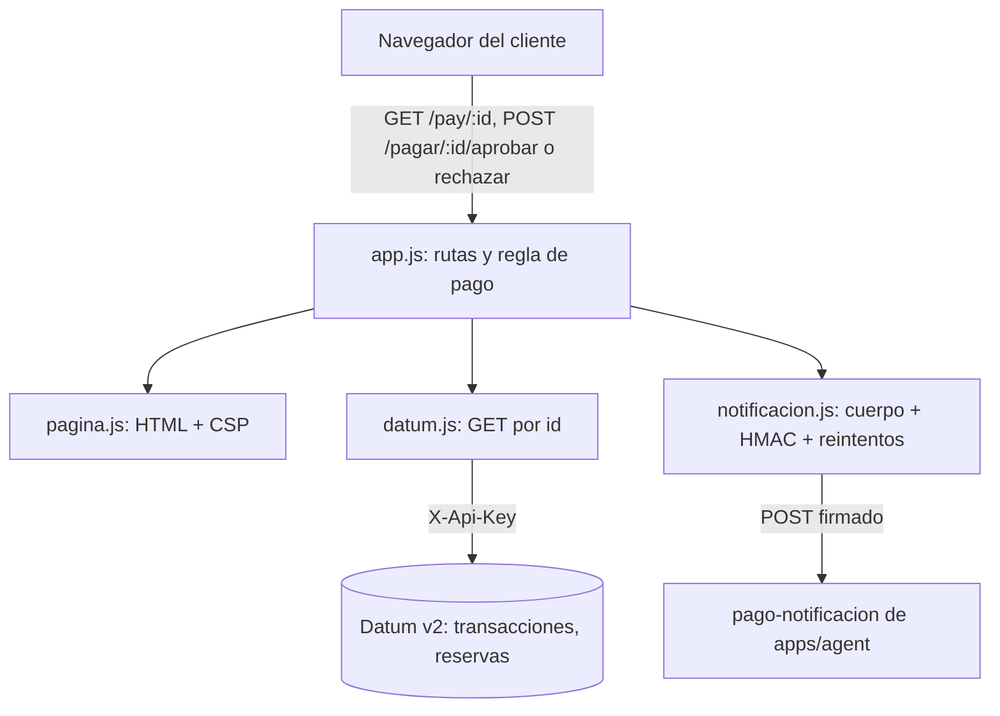

# Technical Design Document: Pasarela de pago simulada (apps/pay)

## 1. Metadata & Traceability
- **Spec:** `reserva-pago-whatsapp-pay`
- **Requirements Ref:** `requirements.md` (spec: `reserva-pago-whatsapp-pay`)
- **Target Stack:** Node 24.22.0 (`node:24.22.0-bookworm-slim`), Express 5.3.0, JavaScript ESM, `node:test`. Sin base de datos propia.

---

## 2. Architecture & System Overview

### 2.1 Architectural Approach
Servicio HTTP pequeño y sin estado en tres módulos con responsabilidad única, con dependencias inyectadas por parámetros para poder probarlo sin red ni reloj real:

- `src/app.js`: rutas Express y reglas de pago (¿es pagable?: `estado = PENDIENTE` y `expira_at > ahora`). `createApp({ datum, now, notificador })`.
- `src/datum.js`: cliente Datum v2 de solo lectura (únicamente `GET` por id). `createDatumClient({ env, fetchFn })`.
- `src/notificacion.js`: cuerpo, firma HMAC y reintentos de la notificación a `pago-notificacion`. `createNotificador({ env, fetchFn, sleep, now })`.
- `src/pagina.js`: render HTML (es/en), escape, formato COP y política CSP.
- `src/server.js`: arranque (carga opcional de `.env`, puerto, cierre ordenado por `SIGTERM`/`SIGINT`).

Pay nunca escribe en Datum: lee `transacciones` y `reservas`, y el efecto de la decisión (asientos, reserva, transacción, reanudación del agente) lo aplica la function pública `pago-notificacion` de `apps/agent` al recibir la notificación. Si `createApp` se invoca sin `datum`, solo publica `/health`: rama usada únicamente por las pruebas (`app.test.js`); `server.js` siempre inyecta el cliente Datum.

Variables de entorno (solo nombres): `PORT_PAY` (opcional, por defecto 3001), `DATUM_URL`, `DATUM_API_KEY`, `PAY_WEBHOOK_SECRET`, `PAGO_NOTIFICACION_URL`.

### 2.2 Component Diagram / Module Interaction


### 2.5 Decisiones cerradas (heredadas de IDEA)
- La pasarela solo notifica APROBADA o RECHAZADA; la expiración la determina el receptor (RN-09): evita que dos actores decidan el mismo estado.
- Reintentos de la notificación: 3 intentos con espera de 1 s y 2 s: cubre fallos transitorios del receptor sin bloquear al cliente.
- Pay es de solo lectura sobre Datum; los efectos los aplica Jelou (RN-10/RN-11): un único escritor del estado.
- Contrato de datos y endpoints único, propiedad de `apps/agent`; pay mantiene una copia con huella verificable.

### 2.6 Riesgos y mitigaciones

| Riesgo | Impacto | Mitigación |
|:---|:---|:---|
| El enlace de pago usa `PAY_PUBLIC_URL` = `http://localhost:3001` (lo construye el agente) | El enlace solo abre en la máquina del usuario que ejecuta la demo | Limitación aceptada de la demo; la base es configurable por entorno |
| Sin autenticación de usuario en la pasarela (mock) | Quien tenga el enlace de una transacción pendiente y vigente puede aprobarla o rechazarla | Aceptado por ser un mock; ids no adivinables generados por Datum; sin dinero real |
| La notificación depende de que `pago-notificacion` acepte la firma (`PAY_WEBHOOK_SECRET` compartido) | Con secreto distinto el receptor responde 401 y el pago no se aplica | 401 es definitivo (un intento) y el cliente ve error de servicio; el secreto se configura en un solo origen del entorno |
| El receptor responde 503 o es inalcanzable | El resultado no se entrega | 3 intentos con espera 1 s y 2 s; luego error de servicio al cliente, que puede reintentar desde el enlace |

### 2.7 Directrices del proyecto
Sin directrices nuevas (rigen las globales de Datum y Express 5.3.0 ya declaradas).

### 2.8 Sujeto a actualización futura
Sin actualizaciones futuras declaradas.

---

## 3. Data Models & Schema Design

> Los datos van primero: pay no define modelo ni base de datos propios. Usa el modelo único de la capacidad ([domain-model](../../agent/domain-model.md), dueña `apps/agent`) y el esquema del contrato copiado en `apps/pay/contract/db-design.dbml` (original: [db-design.dbml](../../agent/reserva-pago-whatsapp-agent/db-design.dbml)).

### 3.1 Domain Entities (Core Business Objects)
Pay solo lee dos entidades del modelo de dominio y no persiste nada:

- **Transacción** (`transacciones`): campos que pay lee: `id`, `estado` (`PENDIENTE | APROBADA | RECHAZADA | EXPIRADA`), `reserva_id`, `expira_at`.
- **Reserva** (`reservas`): campo que pay lee: `total_cop` (entero, COP; monto mostrado).

Regla de pago aplicada por pay (RN-09): una transacción es pagable solo si `estado = PENDIENTE` y `expira_at > ahora`. Una PENDIENTE con `expira_at` vencido se presenta como `EXPIRADA` sin escribirla.

Pertenencia: mono-tenant DEMO; el esquema no tiene columna de cuenta y pay no filtra por cuenta.

### 3.2 Database Schema & Persistence
- **Target Database / Storage:** ninguno propio. Lectura de Datum v2 (PocketBase) por REST, con las colecciones `transacciones` y `reservas` del contrato.
- **Migrations / DDL:** no aplica (sin DDL ni escrituras en pay).
- **Normalización de fechas:** Datum devuelve `date` como `2026-12-01 00:00:00.000Z`; `datum.js` reemplaza el espacio por `T` en todo valor de texto con ese formato antes de que `app.js` compare con la hora actual.

---

## 4. Interfaces, Contracts & API Specifications

### 4.1 Internal Service Interfaces / Ports
```typescript
// datum.js — solo lectura; null si Datum responde 404; lanza DatumError en cualquier otro fallo
getRecord(coleccion: 'transacciones' | 'reservas', id: string): Promise<Record<string, unknown> | null>

// notificacion.js — lanza NotificacionError (configuracion = true si falta secreto o URL)
notificar(transaccionId: string, estado: 'APROBADA' | 'RECHAZADA'): Promise<void>

// app.js
createApp({ datum, now = () => new Date(), notificador = createNotificador() }): express.Express
resolvePort(env = process.env): number // PORT_PAY entero en 1..65535, si no 3001
```

### 4.2 External API / RPC / Event Schemas

#### Endpoints HTTP de pay

El id de ruta debe cumplir `^[A-Za-z0-9_-]{1,64}$`; si no, `400` con `text/plain` `id inválido`, sin consultar Datum. El idioma (`es` por defecto, `en` si `Accept-Language` empieza por `en`) solo afecta el HTML.

| Método y ruta | Entrada | Respuestas |
|:---|:---|:---|
| `GET /health` | Ninguna | `200` `{"status":"ok"}` |
| `GET /pay/:id` y `GET /pagar/:id` (alias) | Id de transacción | `200` HTML: si pagable, monto COP y dos formularios (aprobar y rechazar); si no, solo el estado (`PENDIENTE` vencida se muestra `EXPIRADA`). `400` id inválido. `404` `text/plain` `transacción no encontrada`. `502` `text/plain` `no se pudo consultar la transacción` (falla de Datum en transacción o reserva) o `datos de reserva inválidos` (`total_cop` no entero o negativo). |
| `POST /pagar/:id/aprobar` | Id; cuerpo ignorado | Notifica `APROBADA`. Respuestas abajo. |
| `POST /pagar/:id/rechazar` | Id; cuerpo ignorado | Notifica `RECHAZADA`. Respuestas abajo. |

Respuestas de `POST /pagar/:id/{aprobar|rechazar}` (la transacción se vuelve a leer de Datum en cada POST):
- `200` HTML de confirmación (estado nuevo): notificación aceptada por el receptor.
- `200` HTML con el estado y sin botones: la transacción no está PENDIENTE o está vencida; no se notifica.
- `404` `text/plain` `transacción no encontrada`.
- `502` `text/plain` `no se pudo consultar la transacción`: Datum falla al leer.
- `502` HTML de fallo (`role="alert"` y enlace `Reintentar` a `/pagar/:id`): el receptor agotó los 3 intentos, fue inalcanzable o respondió 4xx definitivo (p. ej. 401).
- `500` `text/plain` `error de configuración`: falta `PAY_WEBHOOK_SECRET` o `PAGO_NOTIFICACION_URL`; no se notifica y el mensaje no incluye el secreto.

Las respuestas HTML (todas las de `GET /pay`, `/pagar` y los `POST` con HTML) llevan cabeceras de seguridad:
- `Content-Security-Policy: default-src 'none'; style-src 'unsafe-inline'; script-src 'sha256-<hash del script inline>'; form-action 'self'; base-uri 'none'` (el hash se calcula en `pagina.js` sobre el único script, que deshabilita los botones al enviar).
- `Cache-Control: no-store`
- `X-Content-Type-Options: nosniff`
- Express sin `X-Powered-By`. Todo valor interpolado en HTML pasa por `esc()` (`& < > " '`) y el id en URLs por `encodeURIComponent`.

#### Cliente Datum (lectura)
- `GET ${DATUM_URL}/collections/{coleccion}/records/{id}` (coleccion e id con `encodeURIComponent`), cabeceras `X-Api-Key: ${DATUM_API_KEY}` y `Accept: application/json`, timeout 5 s.
- `200` con objeto JSON: registro plano con fechas normalizadas. `404`: `null`. Otro estado, falla de red, JSON inválido o cuerpo que no sea objeto: `DatumError` con mensaje fijo (`Datum respondió <status>`, `Datum no disponible`, etc.), que nunca incluye la clave. Falta `DATUM_URL` o `DATUM_API_KEY`: `DatumError('Datum no configurado')`.
- Solo `GET` por id; ninguna otra operación sobre Datum.

#### Notificación a `pago-notificacion`
- **Evento:** `POST ${PAGO_NOTIFICACION_URL}` (function pública de `apps/agent`).
- **Cabeceras:** `Content-Type: application/json` y `X-Webhook-Signature: sha256=<hex>`, con `<hex>` = HMAC-SHA256 hexadecimal del cuerpo crudo con `${PAY_WEBHOOK_SECRET}`. El cuerpo se serializa una sola vez y se firman y envían exactamente esos bytes.
- **Cuerpo:**
```json
{
  "transaccion_id": "<id>",
  "estado": "APROBADA",
  "event_id": "<id>:APROBADA",
  "emitido_at": "2026-10-16T12:00:00.000Z"
}
```
`estado` es `APROBADA` o `RECHAZADA` (cualquier otro lanza error y nunca se envía EXPIRADA); `event_id` es siempre `<transaccion_id>:<estado>`; `emitido_at` es ISO 8601 UTC.
- **Respuestas del receptor (contrato de `pago-notificacion`):** `200 {"resultado":"APLICADO"|"EXPIRADO"|"DUPLICADO"|"SIN_EFECTO"}` (cualquier 2xx es aceptado, el cuerpo no se interpreta); `401` firma inválida; `503` fallo del receptor.
- **Política de reintentos:** hasta 3 intentos con espera de 1000 ms antes del 2.º y 2000 ms antes del 3.º, timeout de 5 s por intento. Se reintenta ante falla de red, `5xx` y `429`. Cualquier otro `4xx` (incluido `401`) corta de inmediato (un solo intento). Agotados los intentos o cortado: `NotificacionError('el receptor no aceptó la notificación')`, que `app.js` traduce a `502`.

---

## 5. Implementation Target Structure (File Mapping)

Servicio plano (sin capas hexagonales): un módulo por responsabilidad, descritos en §2.1.

| Archivo | Rol |
|:---|:---|
| `apps/pay/contract/CONTRACT.sha256` | Huellas SHA-256 de la copia del contrato (`db-design.dbml`, `endpoints.md`) |
| `apps/pay/contract/db-design.dbml` | Copia idéntica del esquema de `apps/agent/contract/` |
| `apps/pay/contract/endpoints.md` | Copia idéntica de los endpoints de `apps/agent/contract/` |
| `apps/pay/.gitignore` | Excluye `.env`, `.env.*` (salvo `.env.example`) y `node_modules/` |
| `apps/pay/package.json` | Dependencia `express` 5.3.0, `engines.node` 24.22.0, scripts `start` y `test` (`node --test`) |
| `apps/pay/package-lock.json` | Lockfile de npm que consume `npm ci --omit=dev` en el `Dockerfile` |
| `apps/pay/src/app.js` | `createApp`, `resolvePort`, rutas HTTP y regla de pago |
| `apps/pay/src/server.js` | Arranque, puerto, cierre ordenado |
| `apps/pay/src/datum.js` | Cliente Datum de solo lectura |
| `apps/pay/src/pagina.js` | HTML es/en, escape, formato COP, CSP |
| `apps/pay/src/notificacion.js` | Notificación firmada con reintentos |
| `apps/pay/src/app.test.js` | Pruebas de salud y puerto |
| `apps/pay/src/datum.test.js` | Pruebas del cliente Datum |
| `apps/pay/src/pagar.test.js` | Pruebas de la página de pago y de los POST |
| `apps/pay/src/notificacion.test.js` | Pruebas de firma, evento y reintentos |
| `apps/pay/Dockerfile` | Imagen `node:24.22.0-bookworm-slim`, `npm ci --omit=dev`, usuario `node`, `EXPOSE 3001`, `HEALTHCHECK` Node contra `/health`, `CMD ["node","src/server.js"]` |
| `apps/pay/.dockerignore` | Excluye `node_modules`, `.env*` (salvo `.env.example`) y `.git` de la imagen |
| `apps/pay/.gitattributes` | Fin de línea LF para `.js`, `Dockerfile`, `*.sh`, `*.yaml` |

### 5.1 Barrido de términos críticos
Sin términos críticos afectados.

### 5.2 Tests afectados por un nuevo corte de migración
Sin cortes de migración afectados.

---

## 6. Traceability Matrix: Requirements to Design
| Requirement ID | Design Section | Implementation File(s) |
|:---|:---|:---|
| REQ-1.1, REQ-1.2 | §3.1 regla de pago; §4.2 `GET /pay/:id` | `src/app.js`, `src/pagina.js` |
| REQ-1.3, REQ-1.4 | §4.2 `404` y `400`; §7.1 | `src/app.js` |
| REQ-1.5 | §4.2 cliente Datum y `502`; §7.1 | `src/datum.js`, `src/app.js` |
| REQ-1.6 | §4.2 cabeceras; §7.2 | `src/pagina.js` |
| REQ-1.7 | §4.2 endpoints e idioma | `src/app.js`, `src/pagina.js` |
| REQ-2.1, REQ-2.3, REQ-2.4 | §4.2 notificación (cuerpo); §7.2 idempotencia | `src/notificacion.js` |
| REQ-2.2 | §4.2 notificación (firma) | `src/notificacion.js` |
| REQ-2.5, REQ-2.6, REQ-2.7 | §4.2 política de reintentos; §7.1 | `src/notificacion.js`, `src/app.js` |
| REQ-2.8 | §4.2 `POST` (no pagable); §7.2 | `src/app.js` |
| REQ-2.9 | §4.2 `POST` (`500`); §7.1 | `src/notificacion.js`, `src/app.js` |
| REQ-2.10 | §7.2 secretos | `src/notificacion.js`, `src/datum.js`, `src/app.js` |
| REQ-3.1, REQ-3.2 | §4.1 `resolvePort`; §2.1 | `src/app.js`, `src/server.js`, `package.json` |
| REQ-3.3 | §4.2 `GET /health` | `src/app.js`, `Dockerfile` |
| REQ-3.4 | §4.2 `GET /pay/:id` y alias | `src/app.js` |
| REQ-4.1, REQ-4.2, REQ-4.3 | §5 (carpeta `contract/`); §8.3 | `contract/CONTRACT.sha256`, `contract/db-design.dbml`, `contract/endpoints.md` |

---

## 7. Error Handling, Edge Cases & Performance Constraints

### 7.1 Error Strategy & Failure Modes
- **Dominio (regla de pago):** estado distinto de PENDIENTE o `expira_at` vencido: HTML con estado y sin botones, y los `POST` no notifican. Transacción inexistente: `404`.
- **Entrada:** id fuera de `^[A-Za-z0-9_-]{1,64}$`: `400` antes de cualquier consulta.
- **Infraestructura Datum:** cualquier `DatumError` (red, estado no 2xx/404, JSON inválido, sin configuración) se captura en `app.js` y se devuelve como `502` con texto fijo; `total_cop` no entero o negativo: `502`. El mensaje no incluye la URL ni la clave.
- **Infraestructura de notificación:** falta de secreto o URL: `500` `error de configuración` sin notificar. Receptor inalcanzable, `5xx`/`429` persistente o `4xx` definitivo: `502` con HTML de fallo y enlace para reintentar. No se da el pago por entregado en ningún caso de error.
- **Rendimiento:** timeouts de 5 s por llamada a Datum y por intento de notificación; peor caso de un POST: 3 intentos más 3 s de esperas. Sin caché (`no-store`).
- **Ciclo de vida:** `SIGTERM`/`SIGINT` cierran el servidor y salen con 0; si no cierra en 10 s, sale con 1.

### 7.2 Security & Isolation
- **XSS:** todo valor proveniente de datos se escapa con `esc()`; CSP con `default-src 'none'`, único script permitido por hash, `form-action 'self'`, `base-uri 'none'`; `nosniff`.
- **Falsificación de la notificación:** firma HMAC-SHA256 sobre el cuerpo crudo con `${PAY_WEBHOOK_SECRET}`, verificada por el receptor antes de tocar datos.
- **Secretos:** `${DATUM_API_KEY}` y `${PAY_WEBHOOK_SECRET}` solo se leen de `env`, nunca aparecen en respuestas, mensajes de error ni logs (el único log propio es el mensaje de arranque con el puerto). `.env` excluido por `.gitignore` y `.dockerignore`.
- **Entrada:** el id se valida con lista blanca antes de usarse y se codifica con `encodeURIComponent` en URLs hacia Datum y en enlaces HTML.
- **Aislamiento de datos:** solo `GET` por id sobre Datum; pay no puede mutar estado de negocio. Mono-tenant DEMO, sin columna de cuenta.
- **Contenedor:** ejecuta como usuario `node` no root.
- **Idempotencia por operación:**
  - `GET /pay/:id`, `GET /pagar/:id`, `GET /health` y `getRecord` de Datum: solo lectura, naturalmente idempotentes.
  - `POST /pagar/:id/aprobar` y `POST /pagar/:id/rechazar`: el `event_id` es determinista (`<transaccion_id>:<estado>`), por lo que repetir el POST (doble clic, reintento del navegador, nueva notificación del mismo resultado) reenvía el mismo evento y el receptor lo responde `DUPLICADO` sin efecto. Además, pay solo notifica si la transacción sigue PENDIENTE y vigente: una vez el receptor la transiciona, nuevos POST devuelven la página de estado sin notificar. Los reintentos internos de un mismo POST reutilizan el mismo cuerpo, firma y `event_id`. La deduplicación efectiva es responsabilidad del receptor (por `event_id`).

---

## 8. Testing Strategy & Verification Plan

Todo se ejecuta en contenedor. 26 pruebas verdes el 2026-10-16:

```
docker run --rm -v C:/repos/jelou-agent/apps/pay:/src:ro node:24.22.0-bookworm-slim sh -c 'mkdir /w && cd /src && tar cf - --exclude=./node_modules . | tar xf - -C /w && cd /w && npm ci && npm test'
```
(En Git Bash, anteponer `MSYS_NO_PATHCONV=1`.)

### 8.1 Unit Tests
- `src/app.test.js` (4): `GET /health` 200 `{"status":"ok"}`; puerto por defecto 3001; `PORT_PAY` sobrescribe; `PORT_PAY` inválido cae a 3001. (REQ-3.1 a REQ-3.3)
- `src/datum.test.js` (4): lectura por id con `X-Api-Key`; fechas normalizadas a ISO; 404 devuelve `null`; fallos sin filtrar la clave. (REQ-1.5)
- `src/notificacion.test.js` (10), con `fetchFn`, `sleep` y `now` inyectados: cuerpo exacto, firma válida sobre el cuerpo crudo y `event_id`; rechazar con `RECHAZADA`; mismo `event_id` al re-notificar; 5xx con 3 intentos y esperas 1 s y 2 s; falla y luego acepta; 401 definitivo con un intento; receptor inalcanzable; no notifica si no es PENDIENTE o está vencida; sin secreto o URL (`500`); secreto ausente de respuestas y logs. (REQ-2.1 a REQ-2.10)

### 8.2 Integration Tests
- `src/pagar.test.js` (8), con `createApp` y `datum` falso por HTTP local: PENDIENTE vigente (monto COP y dos formularios); `/pay/:id` equivalente y `Accept-Language: en`; estado no PENDIENTE sin botones; PENDIENTE vencida como EXPIRADA; `404`; `400` por id inválido; `502` por falla de Datum o total inválido; escape de valores (XSS). (REQ-1.1 a REQ-1.7, REQ-3.4)

### 8.3 Contract / E2E Tests
- Contrato: comprobación por comando, sin test versionado en `apps/pay` (el script `verify-contract.sh` existe solo en `apps/crm`): desde `apps/pay/contract/`, `sha256sum -c CONTRACT.sha256` debe terminar sin diferencias (REQ-4.1 a REQ-4.3). Se ejecutó con resultado correcto en la verificación E2E de infraestructura.
- En vivo contra Datum y Jelou: transacción real leída por id, notificación HMAC aceptada, evento duplicado respondido `200 DUPLICADO` sin efecto y firma inválida rechazada con `401`. La reanudación del agente tras la notificación se verificó en el E2E de la unidad de infraestructura.

---

## 9. Design Review Checklist
- [x] La arquitectura respeta la separación domain/application/infra sin fugas de responsabilidad. (Servicio plano con módulos de una responsabilidad; la regla de pago vive en `app.js`, la I/O en `datum.js` y `notificacion.js`.)
- [x] No hay sobre-ingeniería: la solución es la más simple que resuelve el requerimiento.
- [x] El diseño no anticipa funcionalidad futura (sin mocks, stubs, puertos/inversiones de dependencia, flags, parámetros ni ramas "para cuando llegue X"); toda actualización futura figura solo en §2.8. (La inyección de `fetchFn`, `sleep` y `now` es para pruebas del comportamiento actual.)
- [x] Todo modelo de datos de §3 está declarado en `domain-model.md` y `db-design.dbml`, y el negocio de §4 y §7 se apoya en él.
- [x] Todo requerimiento de `requirements.md` tiene un ítem correspondiente en la matriz de trazabilidad.
- [x] La estrategia de seguridad cubre las amenazas relevantes del caso.
- [x] Si el spec cambia la semántica de un término crítico, el barrido de §5 cubre TODAS sus menciones en contratos y plantillas y ninguna queda con el modelo viejo. (No aplica: §5.1 declara "sin términos críticos afectados".)
- [x] §2.5 recoge todas las decisiones cerradas heredadas y ninguna se reabrió en el diseño; §2.6 mantiene los riesgos heredados vigentes más los que introduce el diseño.
- [x] Si el spec añade o modifica un corte de migración, §5.2 lista TODOS los tests cuyo dato de versión queda por debajo del corte nuevo y ninguna fila queda sin marcar; si no aplica, §5.2 declara explícitamente "sin cortes de migración afectados".
- [ ] REQ-4.1 a REQ-4.3 tienen prueba automatizada versionada en `apps/pay` (no: la verificación es por comando, ver §8.3).
