<div align="center">

# ✈️ Aerolínea · Reservas por WhatsApp

**Un agente conversacional que lleva al cliente desde «quiero viajar» hasta el enlace de pago, sin salir de WhatsApp.**


-0B7285)


</div>

---

## Tabla de contenidos

1. [Resumen](#-resumen)
2. [Qué hace el agente](#-qué-hace-el-agente)
3. [Arquitectura](#-arquitectura)
4. [Flujo de la conversación](#-flujo-de-la-conversación)
5. [CRM de operación](#-crm-de-operación)
6. [Reglas de negocio](#-reglas-de-negocio)
7. [Uso de la plataforma Jelou](#-uso-de-la-plataforma-jelou)
8. [Estructura del repositorio](#-estructura-del-repositorio)
9. [Puesta en marcha](#-puesta-en-marcha)
10. [Pruebas end-to-end](#-pruebas-end-to-end)
11. [Seguridad y privacidad](#-seguridad-y-privacidad)
12. [Limitaciones y próximos pasos](#-limitaciones-y-próximos-pasos)

---

## 📌 Resumen

Esta prueba de concepto (PoC) demuestra que una aerolínea puede vender vuelos nacionales por WhatsApp con una conversación guiada: el cliente toca botones y listas en lugar de llenar formularios, y el agente se apoya en servicios reales para cotizar, retener asientos y generar el cobro.

| | |
|---|---|
| **Rutas** | BOG ⇄ MDE · BOG ⇄ CLO · BOG ⇄ CTG (6 trayectos) |
| **Ventana de viaje** | 1 de diciembre de 2026 al 31 de enero de 2027 |
| **Pasajeros por reserva** | de 1 a 9 |
| **Extras** | equipaje de bodega por pasajero y tramo, una mascota por reserva |
| **Asientos** | mapa visual que el cliente abre desde el chat (Boeing 737-8 MAX) |
| **Pago** | pasarela de demostración (no se cobra dinero real) |
| **Inventario sembrado** | Vuelos en 3 horarios por ruta y fecha (07:00, 12:30, 18:45) |

> [!NOTE]
> Es una **demo**. La pasarela de pago y el CRM son simulados; los datos se guardan en una base de datos de pruebas.

---

## 🤖 Qué hace el agente

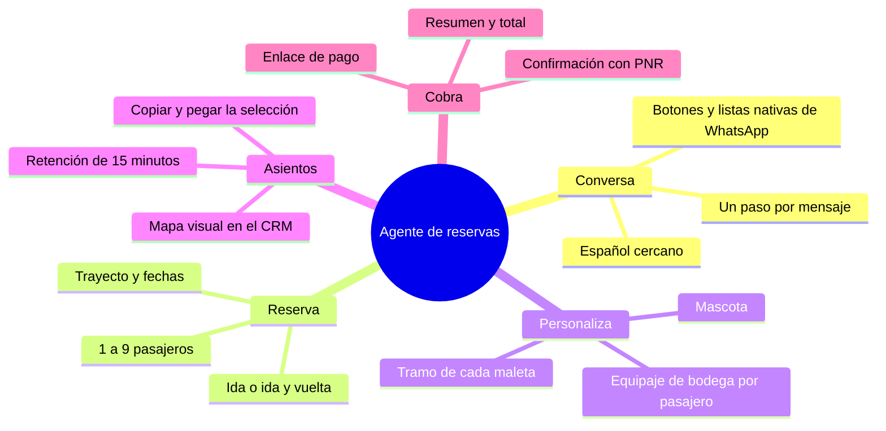

**Principio de diseño:** el agente *solo conversa*. No calcula precios, no valida límites ni inventa disponibilidad; todo eso lo hacen las functions, y el agente copia sus resultados tal cual. Así el negocio vive en código verificable y no en un prompt.

---

## 🏗️ Arquitectura

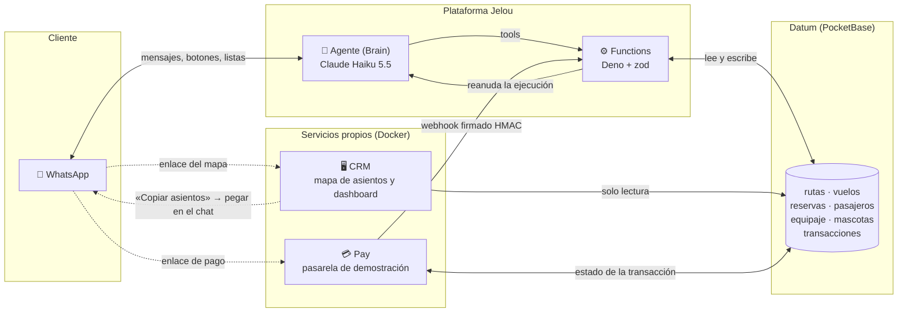

### Componentes

| Componente | Ruta | Tecnología | Responsabilidad |
|---|---|---|---|
| **Agente** | `apps/agent/brain`, `apps/agent/workflow` | Jelou Brain + Claude Haiku 5.5 | Conversación, mensajes interactivos, orquestación de tools |
| **Functions** | `apps/agent/functions` | Deno, zod | Reglas de negocio: precios, equipaje, retención de asientos, reservas, notificación de pago |
| **CRM** | `apps/crm` | Node.js | API de solo lectura y dashboard; sirve el mapa de asientos |
| **Pay** | `apps/pay` | Node.js | Pasarela de demostración (aprobar o rechazar) y webhook |
| **Datos** | `apps/agent/migrations`, `apps/agent/seed` | Datum (PocketBase) | Esquema, migraciones y datos de ejemplo |
| **E2E** | `apps/e2e` | Python, Playwright, Faker | Prueba el flujo completo en WhatsApp Web y graba video |
| **Infraestructura** | `apps/infrastructure` | Docker Compose | Levanta CRM y Pay; contenedor con la CLI de Jelou |

### Tools del agente

| Tool | Qué hace |
|---|---|
| `rutas-listar` | Lista los 6 trayectos y su tarifa base |
| `vuelos-buscar` | Vuelos de ida y vuelta, con enlace al mapa de asientos |
| `equipaje-calcular` | Precio de una maleta de bodega (medidas y peso) |
| `cotizar` | Pasajes, equipaje y mascota; devuelve líneas y total |
| `asientos-validar-retener` | Valida y retiene asientos; entrega un `hold_token` |
| `transaccion-crear` | Crea la reserva pendiente, el PNR y el enlace de pago |
| `pago-notificacion` | *No es una tool*: la llama la pasarela y reanuda al agente |

---

## 💬 Flujo de la conversación

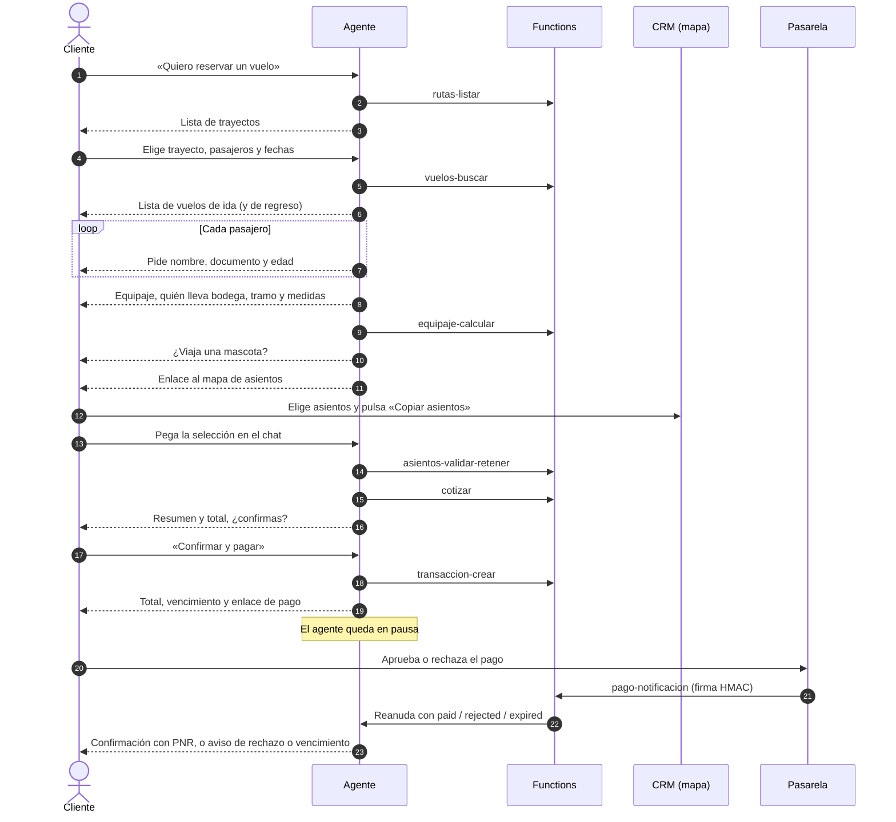

### Estados de una reserva

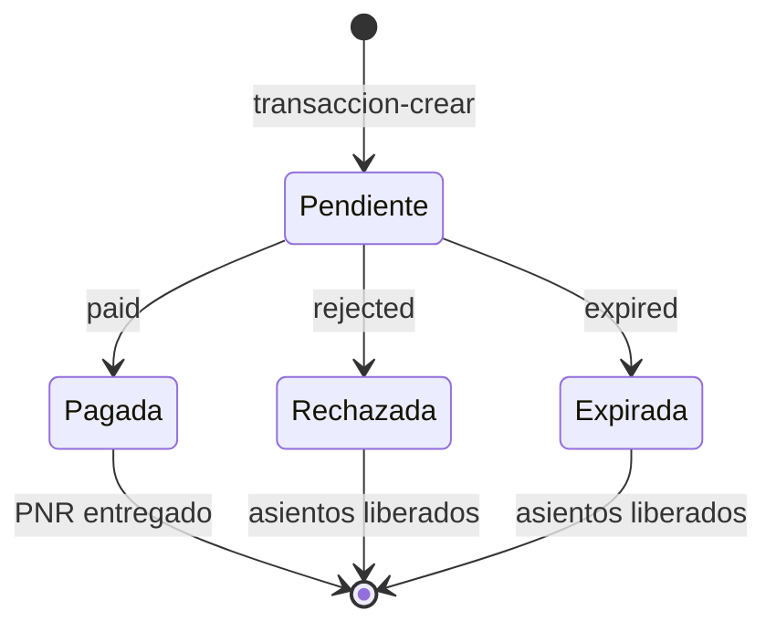

---

## 🖥️ CRM de operación

El CRM es un panel **de solo lectura** (español e inglés, tema claro y oscuro, actualización automática cada 15 s) para ver en vivo lo que vende el agente: ocupación, reservas por estado, ingresos y el mapa de asientos de cada vuelo. 

> **Datos reales, no maquetas.** Todo lo que muestra el CRM se lee en vivo de **Datum** (la base de datos de Jelou): vuelos, mapas de asientos, reservas, pasajeros y pagos. Son los mismos registros que escribe el agente al vender. Para que las capturas luzcan con operación, se cargaron reservas de demostración con `apps/agent/seed/demo.mjs`; las cifras salen de Datum, no están escritas a mano en la interfaz.

### Resumen

Indicadores globales, ocupación por destino, reservas por estado, ventas por fecha y rutas más vendidas.

<div align="center">
  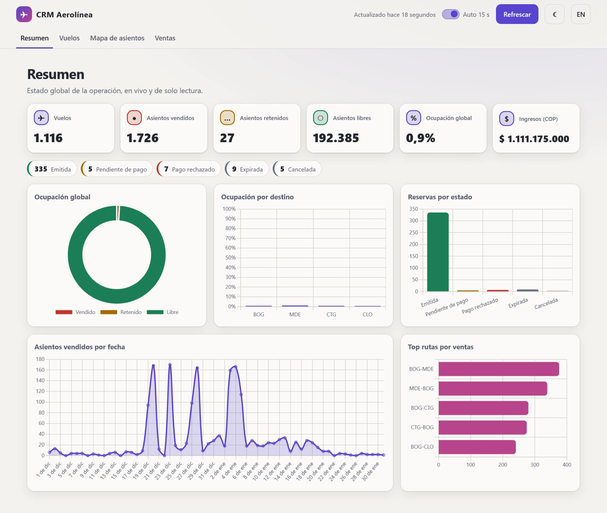
</div>

### Vuelos

Todos los vuelos con filtros por ruta y fechas, columnas ordenables y barra de ocupación.

<table>
  <tr>
    <th align="center">Tema claro</th>
    <th align="center">Tema oscuro</th>
  </tr>
  <tr>
    <td>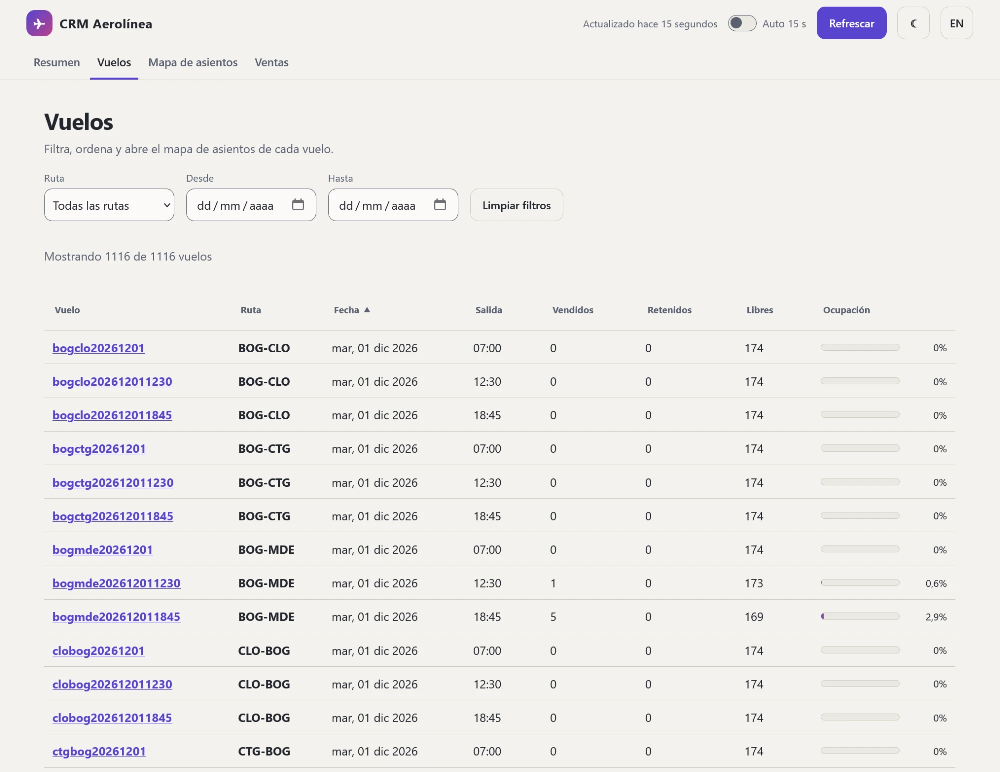</td>
    <td>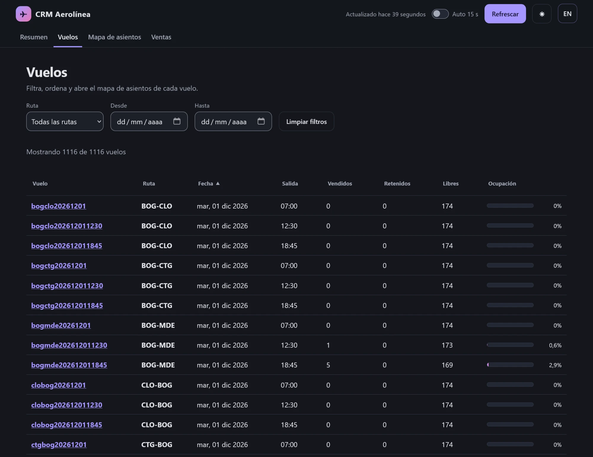</td>
  </tr>
</table>

### Mapa de asientos

Boeing 737-8 MAX por clase, con filas de salida de emergencia y el estado de cada asiento (libre, retenido, vendido o bloqueado).

<table>
  <tr>
    <th align="center">Tema claro</th>
    <th align="center">Tema oscuro</th>
  </tr>
  <tr>
    <td>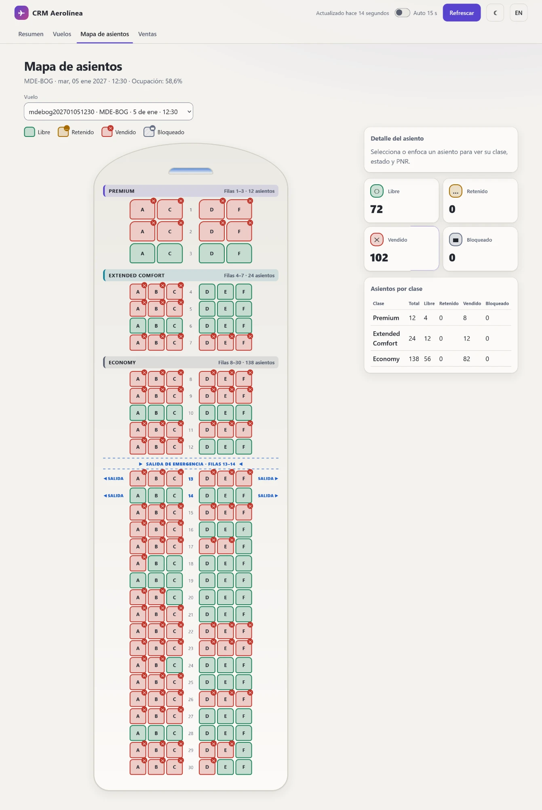</td>
    <td>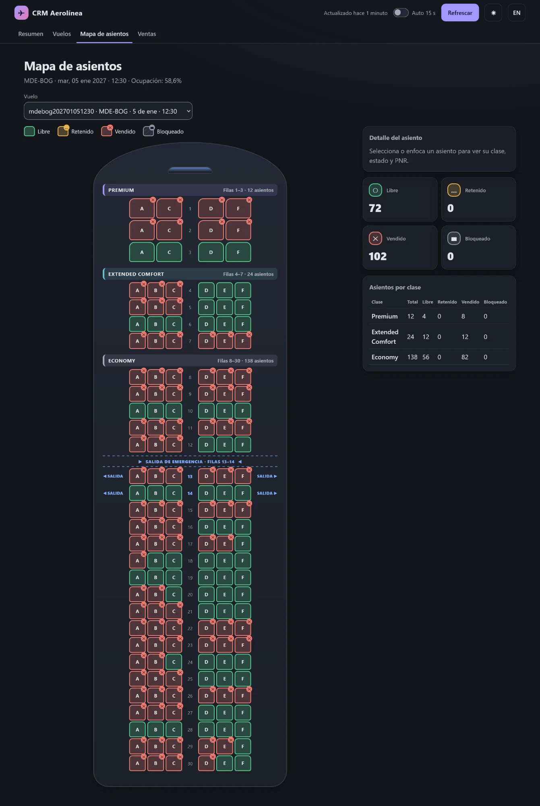</td>
  </tr>
</table>

### Ventas

Gráfica por periodo (día, semana o mes) con los picos marcados, y el detalle por vuelo con pestañas *Todos / Con ventas / Sin ventas* y buscador por palabra clave.

<table>
  <tr>
    <th align="center">Tema claro</th>
    <th align="center">Tema oscuro</th>
  </tr>
  <tr>
    <td>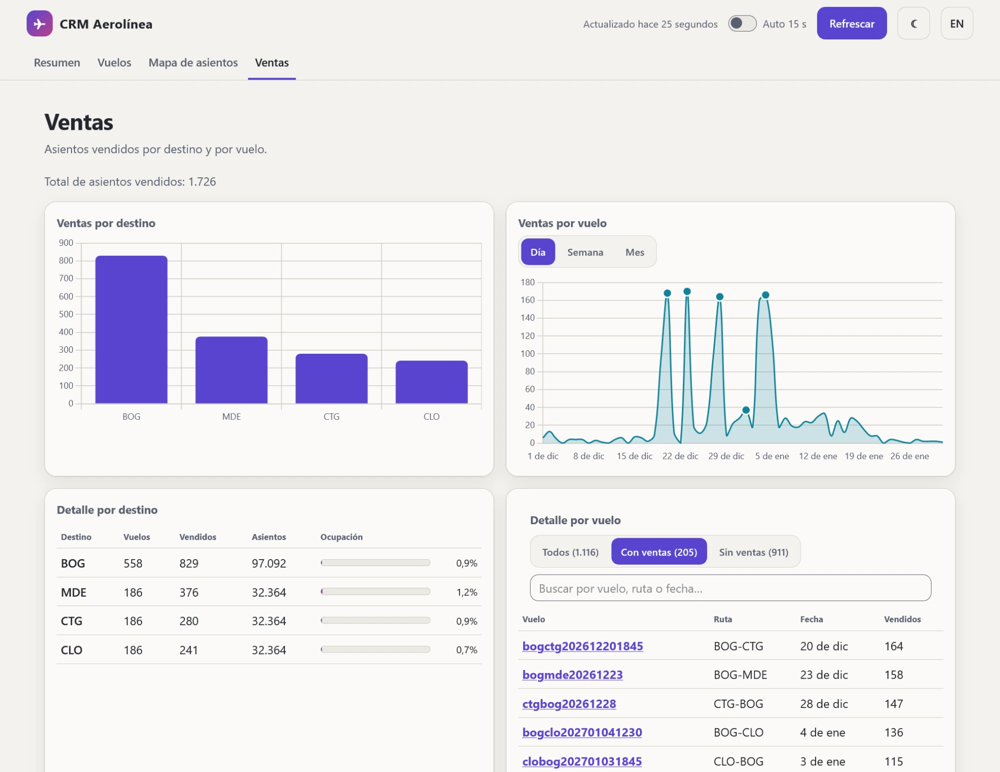</td>
    <td>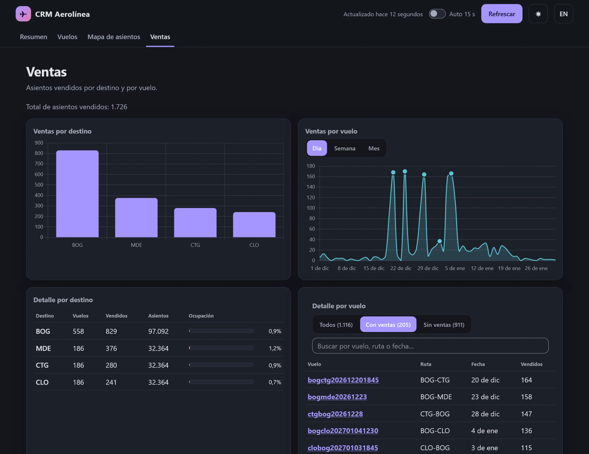</td>
  </tr>
</table>

---

## 📏 Reglas de negocio

Las validan las functions, nunca el prompt.

| Tema | Regla |
|---|---|
| Pasajeros | De 1 a 9 por reserva |
| Fechas | Entre 2026-12-01 y 2027-01-31 |
| Precio del pasaje | Tarifa base de la ruta × multiplicador de temporada del mes |
| Equipaje de cabina | Sin costo y sin medidas |
| Equipaje de bodega | 1 pieza por pasajero y trayecto; largo + ancho + alto ≤ 158 cm; peso ≤ 32 kg |
| Cobro de bodega | Sobre el mayor entre el peso real y el volumétrico, con cargo mínimo |
| Mascota | 1 por reserva, hasta 8 kg, en ida o en regreso |
| Retención de asientos | Unos 15 minutos desde la validación |
| Pagos rechazados o vencidos | Se liberan los asientos; el agente no reintenta el cobro |

---

## 🧩 Uso de la plataforma Jelou

| Capacidad de Jelou | Para qué se usó |
|---|---|
| **Brain (agente de IA)** | Cerebro conversacional con Claude Haiku 5.5 e historial de los últimos 15 mensajes |
| **Canal de WhatsApp** | Entrada y salida de mensajes, sin plantillas HSM |
| **Buttons and list** | Mensajes interactivos nativos: botones (1 a 3 opciones) y listas (4 a 10) |
| **Functions** | Servicios de negocio en Deno publicados como tools del agente |
| **Tools (MCP)** | Conexión del agente con cada function, con secreto a nivel de organización |
| **Pause interaction** | El agente espera el resultado del pago y se reanuda solo |
| **Datum** | Base de datos (PocketBase) con migraciones y semilla |
| **CLI y registros** | Publicar versiones y revisar ejecuciones (`logs chat`, `logs node`) |

---

## 🗂️ Estructura del repositorio

```text
.
├── apps/
│   ├── agent/                  # Todo lo de Jelou
│   │   ├── brain/              # Agente publicado (workflow y tools)
│   │   ├── workflow/           # Prompt del agente y validador
│   │   ├── functions/          # Reglas de negocio (Deno + zod)
│   │   ├── migrations/         # Esquema de Datum
│   │   ├── seed/               # Datos de ejemplo (rutas, vuelos, temporada)
│   │   └── contract/           # Contrato de las functions
│   ├── crm/                    # Dashboard y mapa de asientos (solo lectura)
│   ├── pay/                    # Pasarela de demostración
│   ├── e2e/                    # Pruebas end-to-end con video
│   └── infrastructure/         # Docker Compose y guía de migración de cuenta
├── docs/
│   └── asientos-avion.webp     # Distribución del Boeing 737-8 MAX
└── README.md
```

---

## 🚀 Puesta en marcha

### Requisitos

| Herramienta | Para qué |
|---|---|
| Docker con Compose v2 | CRM, Pay y la CLI de Jelou |
| Cuenta de Jelou | Token del CLI, proyecto de Brain y canal de WhatsApp |
| Base de datos Datum | URL y API key |
| [`uv`](https://docs.astral.sh/uv/) y Google Chrome | Solo para las pruebas e2e |

### 1. Obtener el código

```bash
git clone <url-del-repositorio>
cd jelou-agent
```

### 2. Configurar las variables

```bash
cd apps/infrastructure
cp .env.example .env
```

| Variable | Descripción |
|---|---|
| `JELOU_TOKEN` | Token del CLI de Jelou (`sk_...`) |
| `JELOU_PROJECT_ID` | ID del proyecto de Brain |
| `DATUM_URL` | `https://<slug>.jelou.cloud/api` |
| `DATUM_API_KEY` | API key de Datum |
| `DATABASE_ID` / `DATABASE_SLUG` | Base de datos para migraciones y semilla |
| `PAY_WEBHOOK_SECRET` | Secreto HMAC del webhook de pago (el mismo en `pay` y en las functions) |
| `PAY_PUBLIC_URL` / `PAGO_NOTIFICACION_URL` | URL pública de la pasarela y de la function de notificación |
| `CRM_PUBLIC_URL` | URL pública del CRM (la usan las functions para el enlace del mapa) |
| `PORT_CRM` / `PORT_PAY` | Puertos locales (por defecto 3000 y 3001) |

> [!WARNING]
> `.env` está en `.gitignore`. No subas secretos al repositorio.

### 3. Crear datos y publicar el agente

La plataforma se maneja con la CLI de Jelou dentro de un contenedor. En Git Bash de Windows, exporta `MSYS_NO_PATHCONV=1`.

```bash
# Esquema y datos de ejemplo
docker compose --profile tools run --rm -T --entrypoint bash agent-cli migrations/apply.sh
cd ../agent/seed && node seed.mjs && node seed.mjs --verificar && cd ../../infrastructure

# Functions
docker compose --profile tools run --rm -T agent-cli functions deploy -C /workspace/functions --agent

# Agente (el push solo escribe el borrador; publicar lo deja en producción)
docker compose --profile tools run --rm -T agent-cli push -C /workspace/brain --yes --agent
docker compose --profile tools run --rm -T agent-cli project publish <id-del-proyecto> \
  --commit-name "primera version" --yes --agent
```

> [!TIP]
> Para recrear todo en otra cuenta de Jelou (canal, secretos, tools y versiones), sigue paso a paso [`apps/infrastructure/MIGRAR-CUENTA.md`](apps/infrastructure/MIGRAR-CUENTA.md).

### 4. Levantar CRM y pasarela

```bash
docker compose up --build -d
docker compose ps          # esperar el estado "healthy"
```

| Servicio | URL | Salud |
|---|---|---|
| CRM | http://127.0.0.1:3000 | `/health` |
| Pay | http://127.0.0.1:3001 | `/health` |

Apagar: `docker compose down`.

### 5. Probarlo

Escribe al número de WhatsApp del canal: **«Quiero reservar un vuelo»**.

---

## 🧪 Pruebas end-to-end

Un robot controla Chrome con WhatsApp Web y reserva como una persona real: hace clics reales en botones y listas, abre el mapa de asientos, copia y pega la selección, paga en la pasarela y revisa el CRM. Al final verifica en la base de datos el estado de la transacción, la reserva y los asientos. Puede **grabar un video por pestaña**, útil como demostración.

| Escenario | Qué recorre | Pago |
|---|---|---|
| `una_persona` | Un pasajero, ida y vuelta, equipaje «Cabina y bodega», mascota | Aprobado |
| `varias_personas` | Tres pasajeros con maletas en tramos distintos (ida y regreso, solo regreso y sin bodega) y mascota | Aprobado |
| `flujo_por_mal` | Asiento ocupado, maleta fuera de límites y mascota de más de 8 kg: el agente rechaza y vuelve a pedir | Rechazado, asientos liberados |

```bash
cd apps/e2e
cp .env.example .env                    # define WA_AGENT_PHONE
uv sync
uv run playwright install ffmpeg        # solo si vas a grabar video
uv run python -m e2e.preflight          # valida las functions sin gastar mensajes
uv run python -m e2e.limpiar            # limpia reservas de corridas anteriores
E2E_VIDEO=true uv run pytest -k varias_personas
```

La primera vez se abre Chrome y hay que escanear el QR de WhatsApp Web; las siguientes corridas reutilizan la sesión.

> [!CAUTION]
> WhatsApp prohíbe los clientes automatizados no oficiales. Usa un **número de pruebas**, no tu cuenta principal. La prueba incluye pausas, un tope de mensajes por corrida y un tiempo de espera entre corridas para reducir el riesgo.

Los detalles (variables, errores frecuentes, pruebas offline del guion) están en [`apps/e2e/README.md`](apps/e2e/README.md).

---

## 🔒 Seguridad y privacidad

| Medida | Detalle |
|---|---|
| **Sin cálculos en el prompt** | Precios, límites y disponibilidad salen de las functions |
| **Documentos protegidos** | El agente nunca repite ni resume números de documento; los enmascara |
| **Webhook firmado** | `pago-notificacion` valida una firma HMAC; sin ella responde 401 |
| **Retención con token** | Los asientos se retienen con un `hold_token` que el cliente nunca ve |
| **Anti-inyección** | El agente ignora instrucciones del cliente que pidan saltar validaciones o revelar el prompt |
| **Secretos fuera del código** | Variables en `.env` y secretos de la plataforma; `.env` no se versiona |
| **Puertos locales** | CRM y Pay se publican solo en `127.0.0.1` |

---

## 🛣️ Limitaciones y próximos pasos

| Tema | Estado |
|---|---|
| Pasarela de pago | Simulada; falta integrar un proveedor real |
| Modelo Haiku | A veces añade el nombre del pasajero tras recibir sus datos, o repite texto tras un mensaje interactivo |
| Pregunta de bodega por pasajero (Sí/No) | Se descartó la versión por pasajero: Haiku no la seguía de forma estable; se usa una lista «¿Quién lleva maleta?» |
| Expiración de la conversación | Es corta (10 min) para no heredar historial de corridas previas; debe revisarse antes de producción junto con la retención de asientos |
| Fuera de alcance | Cancelaciones, cambios de vuelo y check-in |

---

<div align="center">

Hecho con la plataforma **Jelou** · Claude Haiku 5.5 · Datum · Docker

</div>
